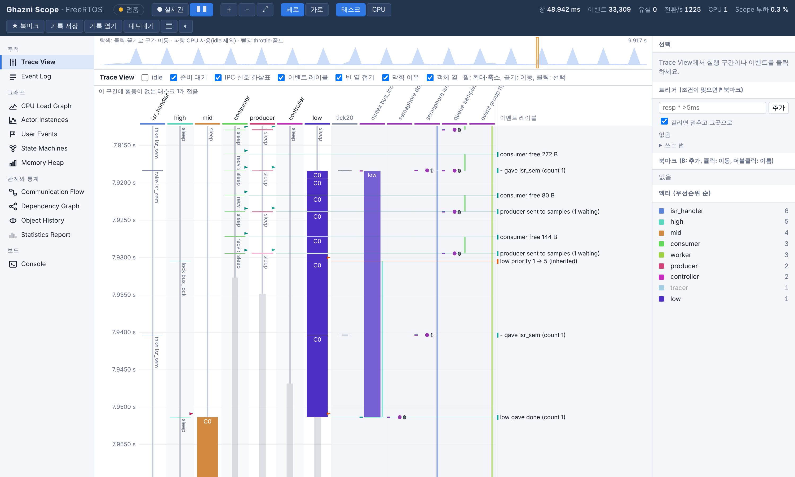

# Ghazni Scope

실시간 운영체제(RTOS)에서 **지금 무슨 일이 일어나는지 브라우저로 보는 도구**입니다. Percepio Tracealyzer의 실시간 보기처럼, 어느 태스크가 언제 CPU를 썼는지, 왜 멈췄는지(어느 큐·세마포어·mutex·이벤트 그룹을 기다렸는지), 인터럽트가 얼마나 걸렸는지, 우선순위 상속이 언제 일어났는지를 시점마다 보여 줍니다. 무료(MIT)입니다.

**지원하는 RTOS**

| RTOS | 기록하는 쪽 | 문서 |
|---|---|---|
| **FreeRTOS** (V11) | 이 저장소의 `targets/freertos` (C 파일 하나 + 헤더) | [docs/FREERTOS.md](docs/FREERTOS.md) |
| **Ghazni** | Ghazni 커널에 내장 (tracer 태스크) | Ghazni 저장소의 `docs/SCOPE.md` |
| 그 밖의 RTOS | 스트림 형식만 맞추면 됨 | [docs/PROTOCOL.md](docs/PROTOCOL.md) |



위 그림은 이 저장소의 FreeRTOS 예제입니다. `high`(우선순위 5)가 `lock bus_lock`으로 막히자 mutex를 잡고 있던 `low`의 우선순위가 1 → 5로 오르고(오른쪽 레이블 "low priority 1 → 5 (inherited)"), 가운데 `mutex bus_lock` 열에 low가 잡고 있던 구간이 보라색 막대로 그려집니다. `consumer`는 `recv samples`(큐가 빔), `isr_handler`는 `take isr_sem`, 그 밖의 태스크는 `sleep`(vTaskDelay)으로 멈춰 있습니다.

## 3분 만에 해 보기 (Linux)

준비물: `gcc`, `make`, `python3`. 다른 설치는 필요 없습니다.

```sh
git clone --recursive https://github.com/bearuse/ghazni-scope
cd ghazni-scope
make demo                 # FreeRTOS(Linux에서 실행)를 빌드해 띄우고 http://localhost:8800 을 엶
```

브라우저에서 <http://localhost:8800>을 열면 화면이 실시간으로 움직입니다. 멈추려면 Space, 확대·축소는 마우스 휠, 전체 보기는 F. 끝내려면 터미널에서 Ctrl+C.

Cortex-M3 마이크로컨트롤러(QEMU가 흉내 내는 ARM MPS2 보드)에서 같은 예제를 돌리려면 `clang`, `lld`, `qemu-system-arm`을 설치하고:

```sh
sudo apt install clang lld qemu-system-arm
make demo-m3
```

`--recursive`를 빠뜨렸다면 `git submodule update --init`으로 FreeRTOS 커널을 받으세요.

## 내 FreeRTOS 프로젝트에 붙이기 (요약)

1. `targets/freertos/scope_freertos.c`와 `include/`, `targets/freertos/`를 빌드에 넣습니다.
2. `FreeRTOSConfig.h` 맨 끝에 `#define configUSE_TRACE_FACILITY 1`을 확인하고 `#include "scope_freertos.h"`를 넣습니다.
3. 보드에 맞는 함수 세 개를 씁니다: 시각(`scope_port_time`), 그 주파수(`scope_port_hz`), 바이트 보내기(`scope_port_write`, 보통 UART).
4. `main()`에서 `vTaskStartScheduler()` 전에 `scope_init()`을 부릅니다.
5. PC에서 `python3 host/ghazni_scope.py --serial /dev/ttyUSB0 --baud 921600`.

자세한 단계, 설정 항목, 인터럽트 기록, 메모리 사용량, 문제 해결은 [docs/FREERTOS.md](docs/FREERTOS.md)에 있습니다.

## 화면

| 화면 | 보여 주는 것 |
|---|---|
| Trace View | 태스크마다 열 하나. 실행 구간(색 막대), 준비됐지만 CPU를 기다린 시간(옅은 띠), 막힌 이유(가는 선과 글: `recv samples`, `lock bus_lock`, `wait flags`, `sleep`), 인터럽트마다 열, 객체(큐·세마포어·mutex·이벤트 그룹)마다 열 |
| Event Log | 모든 이벤트를 시간순 표로, 거르기·찾기 |
| CPU Load Graph | 태스크별 CPU 사용률 |
| Actor Instances | 태스크가 한 번 깨어나 다시 멈출 때까지(인스턴스)의 실행·응답 시간 분포 |
| User Events | `scope_user`(값 그래프), `scope_printf`(글) |
| State Machines | `scope_state`로 알린 상태 변화와 머문 시간 |
| Memory Heap | `pvPortMalloc`/`vPortFree` 사용량, 해제되지 않은 블록 |
| Communication Flow, Dependency Graph | 누가 어느 큐·세마포어에 보내고 누가 받아 깨어났는지 |
| Object History | 객체 하나에 일어난 일을 시간순으로 |
| Statistics Report | 태스크별 실행·응답 시간, CPU %, 스택 사용량, 인터럽트 처리 시간, Scope 자체 부하 |

화면마다 쓰는 법은 [docs/GUIDE.md](docs/GUIDE.md)에, 모든 화면의 캡처와 설명은 [screenshots/](screenshots/README.md)에 있습니다.

## 저장소 구성

```
host/                 PC 쪽 도구 (Python 3, 표준 라이브러리만)
  ghazni_scope.py     스트림을 받아 웹 화면을 띄움
  scope/              프레임 해석(protocol.py), 분석(model.py), 화면(index.html)
include/              스트림 형식(scope_proto.h)과 인코더(scope_encode.h): RTOS와 무관, 헤더만
targets/freertos/     FreeRTOS 기록기 (scope_freertos.c/.h, scope_port.h)
examples/
  common/             두 예제가 같이 쓰는 데모 태스크 (큐, mutex, 세마포어, 이벤트 그룹, 인터럽트)
  freertos-posix/     FreeRTOS를 Linux 프로세스로 (POSIX 포트)
  freertos-mps2/      FreeRTOS를 Cortex-M3에서 (QEMU mps2-an385, UART 출력)
tests/                시험 (make test)
docs/                 문서
third_party/          FreeRTOS-Kernel (서브모듈, V11.3.3, MIT)
```

## 시험

```sh
make test-host        # PC 도구만: 프레임 해석, 분석 모델, C 인코더와 Python 해석기가 맞는지
make test             # + FreeRTOS를 Linux와 Cortex-M3(QEMU)에서 실제로 돌려 확인
```

`tests/run_freertos.py`는 예제를 실제로 돌려 받은 스트림에서 다음을 확인합니다: 유실 0, 모든 태스크 이름, 객체 이름과 종류(큐 1, mutex 1, 세마포어 2, 이벤트 그룹 1), 막힌 이유(consumer는 큐, high는 mutex, worker는 이벤트 그룹, isr_handler는 세마포어), mutex를 잡은 태스크와 시간, 매 주기 우선순위 상속(1 → 5 → 1), 큐에 쌓인 개수, 세마포어 개수, 20 ms마다 들어오는 인터럽트와 처리 시간, printf 글·상태 기계·사용자 값, 힙, 스택 사용량. GitHub Actions가 푸시마다 돌립니다.

## English summary

Ghazni Scope is a free (MIT) live trace viewer for RTOSes, similar in spirit to Percepio Tracealyzer's live view. A small recorder on the target streams compact, COBS-framed events over any byte channel (UART, stdout, TCP); `host/ghazni_scope.py` decodes them and serves a browser UI with a trace view (per task, per interrupt and per kernel object columns, blocking reasons, priority inheritance), event log, CPU load, instance graphs, user events, state machines, heap tracking, communication flow and statistics.

- FreeRTOS V11: `targets/freertos` hooks FreeRTOS's trace macros (include `scope_freertos.h` at the end of `FreeRTOSConfig.h`, provide three port functions, call `scope_init()`). See `docs/FREERTOS.md`.
- Ghazni: the kernel has the recorder built in.
- Other RTOSes: implement the stream format in `docs/PROTOCOL.md` (`include/scope_encode.h` does the encoding).

Try it: `git clone --recursive …; make demo` (FreeRTOS POSIX port on Linux) and open http://localhost:8800. `make test` runs the host unit tests and end-to-end checks on Linux and on a Cortex-M3 under QEMU.

## 라이선스

MIT ([LICENSE](LICENSE)). FreeRTOS-Kernel도 MIT입니다.
