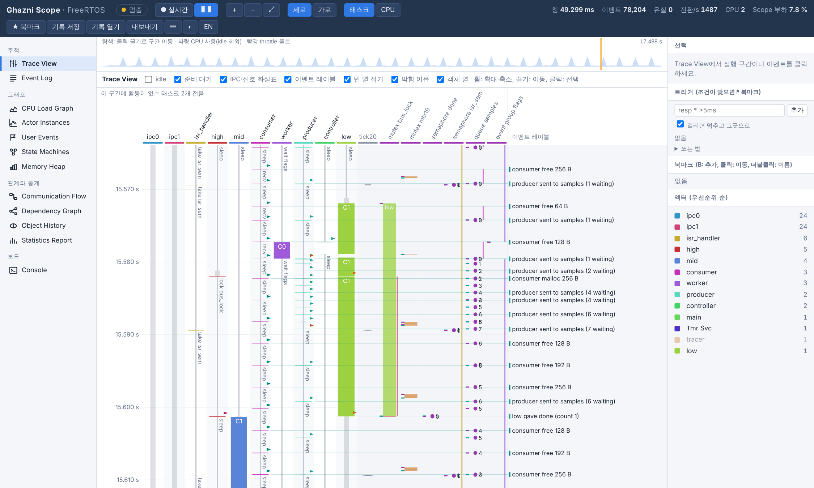

# ESP32 (ESP-IDF)에 Ghazni Scope 붙이기

ESP-IDF는 FreeRTOS를 품고 있지만 일반 FreeRTOS와 몇 가지가 다릅니다. 그래서 따로 준비한 **컴포넌트** `targets/esp-idf/ghazni_scope`를 씁니다. 프로젝트에 두 줄만 더하면 됩니다.



위 그림은 이 저장소의 예제(`examples/esp-idf`)를 Espressif의 QEMU(ESP32, CPU 2개)에서 돌린 것입니다. 막대 안의 `C0`, `C1`은 어느 CPU에서 돌았는지입니다. `low`·`mid`·`high`는 CPU 1에 묶었고(같은 CPU여야 우선순위 역전이 생김), 나머지는 두 CPU를 오갑니다.

## 1. 붙이는 법

**(1) 프로젝트의 `CMakeLists.txt`**, `project()` 줄보다 위에:

```cmake
set(EXTRA_COMPONENT_DIRS /path/to/ghazni-scope/targets/esp-idf)
```

**(2) `sdkconfig.defaults`** (또는 `idf.py menuconfig`):

```
CONFIG_FREERTOS_USE_TRACE_FACILITY=y        # 필수: 태스크·큐 번호
CONFIG_FREERTOS_QUEUE_REGISTRY_SIZE=16      # 큐·세마포어·mutex 이름 (0이면 vQueueAddToRegistry가 아무 일도 안 함)
CONFIG_HEAP_USE_HOOKS=y                     # Memory Heap 화면 (선택)
CONFIG_ESP_CONSOLE_UART_BAUDRATE=921600     # UART가 빠를수록 유실이 적음 (선택)
```

**(3) 코드**: 쓰는 컴포넌트의 `REQUIRES`에 `ghazni_scope`를 넣고,

```c
#include "scope_freertos.h"

void app_main(void)
{
    scope_init();                          /* tracer 태스크를 만듦 */
    scope_isr_name(1, "my_timer");         /* 인터럽트 이름 (선택) */
    /* ... 여러분의 태스크 ... */
}
```

이미 스케줄러가 돌고 있는 `app_main`에서 불러도 됩니다. 그보다 먼저 만들어진 ESP-IDF의 태스크(`ipc0`, `ipc1`, `main`, `Tmr Svc` 등)도 이름이 그대로 나옵니다.

**(4) 보기**: 보드를 굽고 PC에서

```sh
idf.py flash
ghazni-scope --serial /dev/ttyUSB0 --baud 921600      # idf.py monitor는 끄고
```

프레임은 콘솔과 같은 UART0으로 나갑니다. ESP-IDF의 로그 줄은 Console 화면에 그대로 나옵니다. 다른 UART로 보내려면 컴포넌트에 `-DSCOPE_UART=UART_NUM_1`을 주세요.

## 2. 컴포넌트가 하는 일 (일반 FreeRTOS와 다른 점)

| 다른 점 | 컴포넌트가 하는 일 |
|---|---|
| ESP-IDF의 `FreeRTOSConfig.h`는 고칠 수 없음(끝에 헤더를 넣을 수 없음) | FreeRTOS 컴포넌트에 `-include scope_freertos.h`를 줌. FreeRTOS는 이미 정의된 trace 매크로를 그대로 두므로 우리 것이 쓰임 |
| 지금 도는 태스크가 `pxCurrentTCBs[CPU]` | 매크로가 그것을 씀 |
| CPU가 2개: 두 CPU가 동시에 이벤트를 씀 | 이벤트 링을 CPU마다 하나씩 두고, 각 CPU는 자기 링에만 씀(인터럽트만 막으면 됨, CPU 사이 잠금 없음). tracer가 시각순으로 합쳐 보냄. 시각은 두 CPU가 같은 시계(`esp_timer`, 1 µs) |
| 세마포어 가져가기, 인터럽트에서 주기에 ESP-IDF만의 매크로 | `traceQUEUE_SEMAPHORE_RECEIVE`, `traceQUEUE_GIVE_FROM_ISR`도 정의 |
| 힙이 FreeRTOS의 `pvPortMalloc`가 아니라 `heap_caps` | `CONFIG_HEAP_USE_HOOKS`의 훅(`esp_heap_trace_alloc_hook`/`_free_hook`)으로 기록. 해제 훅은 크기를 주지 않아 할당 때의 크기를 씀 |
| ESP-IDF가 미리 만드는 mutex·세마포어가 20개쯤, 태스크가 10개쯤 | 객체 96개, 태스크 48개까지 기록 |
| UART 드라이버가 FreeRTOS 큐를 씀(보내기가 이벤트를 만듦) | tracer는 한 번에 그 순간까지 쌓인 것만 보냄(보내며 생긴 이벤트는 다음 차례) |

ESP-IDF가 만든 mutex(`mtx0`, `mtx19` …: newlib 잠금 등)도 객체 열에 보입니다. 이름이 없는 것은 기본 이름이 붙습니다.

## 3. 하드웨어 없이 해 보기 (QEMU)

```sh
cd examples/esp-idf
make            # ESP-IDF가 설치돼 있으면 그것으로, 없으면 Docker 이미지 espressif/idf:v5.3.2로 빌드
make run        # Espressif의 QEMU(ESP32)에서 돌리고 http://localhost:8800
```

Docker만 있으면 됩니다(이미지 약 3 GB를 처음에 받음). QEMU는 ESP-IDF에 들어 있는 Espressif판을 씁니다(`examples/esp-idf/qemu.sh`).

## 4. 확인한 것과 아직 못 한 것

- **확인함**: `tests/run_freertos.py esp32`가 QEMU의 ESP32(CPU 2개)에서 다른 예제와 똑같은 15가지(유실 0, 막힘 이유, mutex를 잡은 구간, 매 주기 우선순위 상속, 큐·세마포어 개수, 인터럽트, 통신 흐름, 힙, 스택 …)와, 두 CPU가 모두 태스크를 돌리고 CPU 1에 묶은 태스크는 CPU 1에서만 도는지를 확인합니다. 모두 통과했고 CI에서 돌립니다. ESP-IDF v5.3.2, ESP-IDF의 기본 FreeRTOS(IDF FreeRTOS)입니다.
- **아직 못 함**: 실제 ESP32 보드. ESP32-S3, ESP32-C3(RISC-V, CPU 1개) 같은 다른 칩. menuconfig의 "Amazon SMP FreeRTOS" 선택. QEMU에서 Scope 자체 부하가 9~10 %로 나오는데(UART 드라이버), 실제 보드에서는 재 보지 않았습니다.
