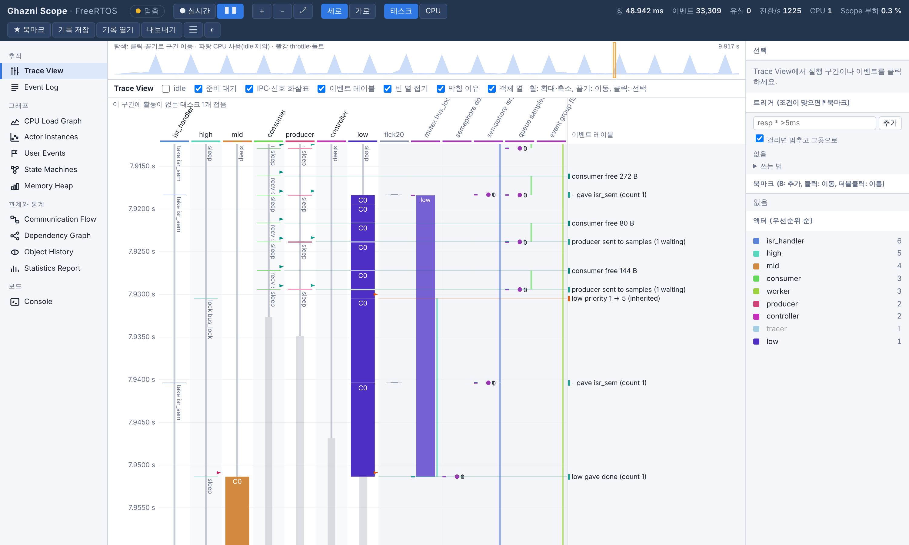
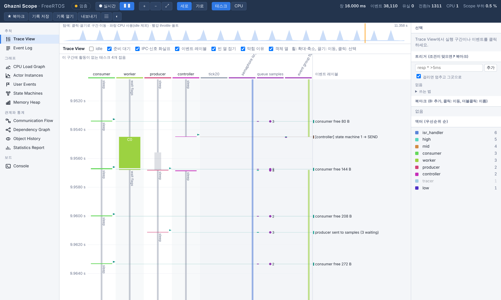
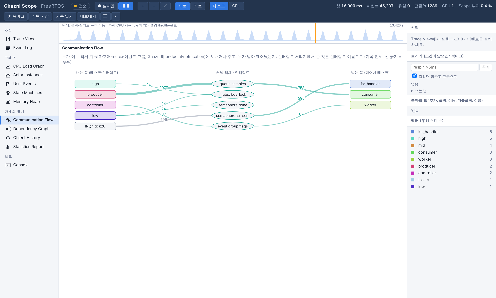
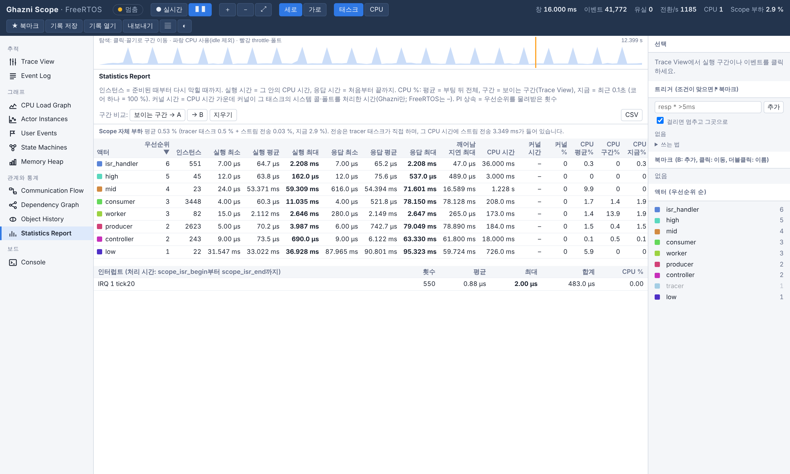

# Ghazni Scope 화면 사용법

이 문서는 브라우저 화면을 처음 보는 분을 위한 안내입니다. 그림은 이 저장소의 FreeRTOS 예제(`make demo`)이고, Ghazni에서도 화면은 같습니다(Ghazni에는 endpoint·IPC 같은 것이 더 나옴).

## 1. 띄우기

```sh
python3 host/ghazni_scope.py <연결 방법>
```

그리고 브라우저에서 <http://localhost:8800>을 엽니다. 도구를 끄면(Ctrl+C) 화면도 멈춥니다.

| 연결 방법 | 언제 |
|---|---|
| `--serial /dev/ttyUSB0 --baud 921600` | 보드의 UART (USB-시리얼). `pip install pyserial` 필요. Windows는 `COM5` 같은 이름 |
| `--exec "명령"` | 표준 출력으로 스트림을 내는 프로그램: FreeRTOS POSIX 포트, QEMU `-serial stdio` |
| `--tcp 호스트:포트` | TCP로 바이트를 주는 곳: QEMU `-serial tcp:...`, ser2net, 보드의 TCP 서버 |
| `--replay 파일` | 저장해 둔 기록(`--record`나 화면의 `기록 저장`으로 만든 것) |
| `--qemu ELF`, `--net 주소` | Ghazni 전용 (Ghazni 문서 참고) |

그 밖의 옵션:

| 옵션 | 뜻 |
|---|---|
| `--port 8800` | 웹 화면 포트 |
| `--record raw.bin` | 받은 바이트를 그대로 저장 (나중에 `--replay`) |
| `--perfetto out.json` | 끝날 때 Perfetto 형식으로 저장 (<https://ui.perfetto.dev>에서 열림) |
| `--trigger "조건"` | 조건 트리거 (아래 4절), 여러 번 줄 수 있음 |
| `--check 5` | 브라우저 없이 5초 모으고 요약을 출력하고 끝냄(시험용). `SCOPE_JSON=파일`을 환경에 주면 요약을 JSON으로 |
| `--quiet` | 콘솔 글을 터미널에 찍지 않음 |

## 2. 화면 구성



- **맨 위 막대**: 제목 옆에 어느 OS인지(`· FreeRTOS`). 멈춤/실시간, 확대(+)·축소(−)·전체(⤢), 세로/가로, 열을 태스크로/CPU로. 오른쪽에 지금 보이는 구간의 길이(창), 받은 이벤트 수, **유실**(0이 아니면 타깃에서 이벤트를 버린 것), 초당 문맥 전환, CPU 수, **Scope 부하**(관측 도구 자신이 쓰는 CPU).
- **둘째 줄**: 북마크, 기록 저장·열기, 내보내기(Perfetto), 왼쪽 메뉴 접기, 오른쪽 패널 접기.
- **탐색 막대**(화면 위쪽 파란 그래프): 기록 전체의 CPU 사용. 클릭하거나 끌면 그 시점으로 갑니다. 노란 상자가 지금 보이는 구간입니다.
- **왼쪽**: 화면 목록.
- **오른쪽**: 선택한 것의 자세한 정보, 트리거, 북마크, 액터(태스크) 목록. 액터 이름을 클릭하면 숨기고 다시 클릭하면 보입니다. `tracer`(Scope 자신)는 처음에 숨겨져 있습니다.

키보드: Space 멈춤/실시간, + − 확대·축소, F 전체, B 북마크. 마우스: 휠 확대·축소, 끌기 이동, 클릭 선택.

## 3. 화면마다

### Trace View — 시점마다 무슨 일이 있었나

태스크마다 세로 열 하나(가로 보기면 줄 하나)입니다. 시간은 위에서 아래로 흐릅니다.

| 모양 | 뜻 |
|---|---|
| 색 막대 (안에 `C0`) | 태스크가 CPU 0에서 실행됨 |
| 옅은 회색 띠 | 준비됐지만 CPU를 기다림(더 높은 우선순위가 돌고 있음) |
| 가운데 가는 선과 세로 글 | **막혀 있음**, 그리고 무엇을 기다리는지: `recv samples`(큐가 빔), `send → samples`(큐가 가득), `lock bus_lock`(mutex), `take isr_sem`(세마포어), `wait flags`(이벤트 그룹), `sleep`(vTaskDelay) |
| 작은 삼각형 화살표 | 누가 누구를 깨웠나 (큐에 보내 받는 쪽을 깨움 등) |
| 깃발 | 사용자 이벤트, 우선순위 변화 |
| 인터럽트 열 (예: `tick20`) | 인터럽트 처리기가 돈 구간 |
| 객체 열 (예: `mutex bus_lock`) | mutex는 잡고 있던 태스크의 색 막대, 큐·세마포어는 주고받은 순간과 그때의 개수(● 옆 숫자) |
| 오른쪽 **이벤트 레이블** 열 | 그 시점에 일어난 일을 글로: "low priority 1 → 5 (inherited)", "producer sent to samples (3 waiting)" |

위 체크 상자로 켜고 끕니다: idle(CPU가 쉰 시간), 준비 대기, 화살표, 이벤트 레이블, **빈 열 접기**(보이는 구간에 아무 일도 없던 태스크 열을 접음), 막힘 이유, 객체 열.

실행 막대를 클릭하면 오른쪽 '선택'에 그 실행의 시작·끝, 실행 시간, 응답 시간(깨어난 때부터 다시 멈출 때까지), 우선순위가 나옵니다.

**그림 읽기(우선순위 역전)**: 7.928 s에 `high`가 `lock bus_lock`으로 막힙니다. mutex를 잡고 있던 `low`의 우선순위가 1 → 5로 오릅니다(레이블). 그래서 15 ms 뒤 깨어난 `mid`(4)가 `low`를 밀어내지 못하고, `low`가 일을 끝내 `done`을 주고 mutex를 풀면(7.951 s) 그제야 `mid`가 돕니다. 우선순위 상속이 없었다면 `high`는 `mid`의 50 ms만큼 더 기다렸을 것입니다.



**그림 읽기(큐·이벤트 그룹)**: `producer`가 큐 `samples`에 보내면(레이블 "1 waiting") `recv samples`로 막혀 있던 `consumer`가 깨어납니다(화살표). `controller`가 상태 SEND로 가며 이벤트 그룹 `flags`에 비트를 세우면 `wait flags`로 기다리던 `worker`가 2 ms 일합니다.

### Event Log

모든 이벤트를 시간순 표로 봅니다. 위쪽에서 종류별로 거르고, 글로 찾습니다. '보이는 구간만'을 끄면 기록 전체. 줄을 클릭하면 Trace View의 그 시점으로 갑니다.

### CPU Load Graph

100 ms마다 태스크별 CPU 사용률을 쌓은 그래프. 어느 태스크가 언제 CPU를 많이 썼는지 봅니다.

### Actor Instances

태스크가 한 번 깨어나 일하고 다시 멈출 때까지를 **인스턴스**라 합니다. 인스턴스마다 실행 시간(CPU를 쓴 시간) 또는 응답 시간(처음부터 끝까지)을 점으로 찍습니다. 위로 튄 점이 "가끔 오래 걸린 때"이고, 클릭하면 그 순간의 Trace View로 갑니다.

### User Events

`scope_user(채널, 값)`의 값은 채널마다 그래프로, `scope_printf`의 글은 그래프 위 띠와 아래 표로 나옵니다.

### State Machines

`scope_state(기계, "상태")`로 알린 상태가 언제 바뀌었는지 타임라인으로, 상태마다 머문 시간(횟수·평균·최대)과 전이 횟수를 표로. 끌어서 확대, 더블클릭으로 전체 기록.

### Memory Heap

`pvPortMalloc`/`vPortFree`(Ghazni는 `malloc`/`free`)의 사용량 변화, 태스크별 지금·최대 사용량, **아직 해제되지 않은 블록**(주소, 크기, 할당 시각: 누수 찾기), 경고(해제되지 않은 주소에 다시 할당, 모르는 블록 해제). 다른 태스크가 해제한 블록은 할당한 태스크에서 뺍니다. 스케줄러 시작 전 할당(태스크·큐 생성)은 "-"(없음)로 셉니다.

### Communication Flow



왼쪽은 보낸 쪽(태스크, 인터럽트), 가운데는 객체, 오른쪽은 그 객체를 기다리다 깨어난 태스크. 선 굵기와 숫자가 횟수입니다. 위 그림: `producer`가 큐 `samples`에 2977번 보냈고 `consumer`가 753번 깨어났습니다(나머지는 consumer가 이미 깨어 있을 때 쌓임). 인터럽트 `tick20`이 세마포어 `isr_sem`을 596번 주고 `isr_handler`가 596번 깨어났습니다.

### Dependency Graph

태스크 사이의 관계만 간추린 그림: 누가 누구를 깨우는지(신호), Ghazni라면 누가 누구에게 CALL하고 답을 얼마나 기다렸는지.

### Object History

객체 하나(큐, 세마포어, mutex, 이벤트 그룹)를 골라 그것에 일어난 일(보냄·줌, 받음·가져감과 그때의 개수)을 시간순으로 봅니다. 줄을 클릭하면 그 시점으로.

### Statistics Report



태스크마다 인스턴스 수, 실행·응답 시간(최소·평균·최대), 최장 깨어남 지연(준비된 뒤 CPU를 받기까지), CPU 시간, CPU %(평균 = 처음부터, 구간 = 보이는 구간, 지금 = 최근 0.1초), 우선순위 상속 횟수, 스택(쓴 양 / 크기). 열 제목을 클릭하면 정렬합니다. 아래 표는 인터럽트마다 횟수·평균·최대·합계·CPU %, 맨 위는 Scope 자체 부하입니다.

**구간 비교**: Trace View에서 한 구간을 보고 `보이는 구간 → A`, 다른 구간을 보고 `→ B`를 누르면 두 구간의 CPU %, 인스턴스 수, 최대 시간을 나란히 보여 줍니다. "평소"와 "문제가 생긴 때"를 비교할 때 씁니다.

### Console

타깃의 콘솔 글(프레임 사이의 printf 출력). 아래 입력 칸에 쓴 글은 타깃으로 보내집니다(타깃이 받는 경우: UART, `--exec` 프로그램의 표준 입력).

## 4. 조건 트리거 — 드문 문제를 기다렸다가 잡기

오른쪽 '트리거'에 조건을 넣고 `추가`하면, 조건이 맞을 때마다 ⚑ 북마크가 생깁니다. '걸리면 멈추고 그곳으로'를 켜 두면 실시간 화면이 그 순간에서 멈춥니다. 조건은 도구(서버)가 모든 이벤트에 대해 확인하므로 브라우저가 놓치는 것이 없습니다.

| 조건 | 뜻 |
|---|---|
| `resp consumer >5ms` | consumer 인스턴스의 응답 시간이 5 ms를 넘음 (`*` = 아무 태스크) |
| `exec * >1ms` | 실행 시간이 1 ms를 넘음 |
| `lat high >200us` | high가 깨어난 뒤 CPU를 받기까지 200 µs를 넘음 |
| `isr tick20 >50us` | 인터럽트 처리 시간 (이름이나 번호) |
| `user 1 >900`, `user 1 <10` | 사용자 이벤트 채널 1의 값 |
| `state 1 SEND` | 상태 기계 1이 SEND에 들어감 |
| `heap` | 힙 경고 |
| `fault`, `throttle 태스크` | Ghazni 전용 (폴트, CPU 예산 소진) |

명령줄에서는 `--trigger "resp consumer >5ms"`. `--check`와 같이 쓰면 끝에 트리거마다 몇 번 걸렸는지 출력합니다.

## 5. 저장과 공유

- **기록 저장**: 지금까지 받은 스트림을 그대로 파일(`.gzscope`)로 받습니다. 동료에게 보내면 `기록 열기`나 `--replay`로 똑같이 봅니다. 도구는 256 MB까지 보관합니다.
- **CSV**: Event Log, User Events, State Machines, Memory Heap, Object History, Statistics Report 표마다 `CSV` 단추(엑셀에서 한글이 깨지지 않게 BOM 포함).
- **내보내기**: Perfetto 형식(JSON).
- **북마크**: B 키. 탐색 막대와 Trace View에 ★로, 오른쪽 목록에서 클릭하면 이동, 더블클릭하면 이름 바꾸기.
- 체크 상자, 숨긴 태스크, 세로·가로, 밝게·어둡게(◐), 북마크는 브라우저에 저장되어 다음에 그대로 열립니다.

## 6. 숫자를 믿어도 되나

- **유실**이 0이면 타깃이 기록한 이벤트를 모두 받은 것입니다. 0이 아니면 그 수만큼 빠졌고, 그 근처의 실행 막대·막힘 정보는 틀릴 수 있습니다(FREERTOS.md 5절에서 줄이는 법).
- 시각은 타깃의 타이머로 잰 것이라 PC의 수신 지연과 무관합니다. 정밀도는 `scope_port_time`의 눈금입니다.
- **Scope 부하**는 Scope 때문에 타깃이 쓴 CPU입니다. 다른 태스크의 숫자는 Scope가 없을 때보다 이만큼 나쁘게 보일 수 있습니다.
- FreeRTOS POSIX 예제는 Linux 위에서 돌므로 Linux 스케줄러 때문에 시간이 가끔 튑니다. QEMU는 실제 칩의 속도를 흉내 내지 않습니다. 성능 숫자는 실제 보드에서 보세요.
