# Ghazni Scope 사용 매뉴얼

인쇄하거나 따로 보관하려면 PDF판: [Ghazni-Scope-Manual.pdf](pdf/Ghazni-Scope-Manual.pdf) (`make manual-pdf`로 다시 만듦).

이 매뉴얼은 Ghazni Scope를 처음 쓰는 분이 **설치 → 첫 실행 → 내 보드에 붙이기 → 화면 읽기 → 문제 찾기**까지 순서대로 따라갈 수 있도록 썼습니다. 처음부터 읽어도 되고, 필요한 장만 골라 읽어도 됩니다.

| 이런 분은 | 여기부터 |
|---|---|
| 일단 한 번 보고 싶다 | [2장 설치](#2-설치), [3장 5분 만에 해 보기](#3-5분-만에-해-보기) |
| 내 FreeRTOS 보드에 붙이고 싶다 | [4장 타깃에 붙이기](#4-타깃에-붙이기) |
| 화면이 무슨 뜻인지 알고 싶다 | [5장 화면 둘러보기](#5-화면-둘러보기), [6장 화면별 사용법](#6-화면별-사용법) |
| 문제를 찾고 있다 | [7장 문제 찾기](#7-문제-찾기-사례로-배우기) |
| 무언가 잘 안 된다 | [11장 문제 해결](#11-문제-해결) |

더 자세한 문서: 화면 하나하나의 설명은 [GUIDE.md](GUIDE.md), 모든 화면의 캡처는 [screenshots/](../screenshots/README.md), 연결 방법은 [FREERTOS.md](FREERTOS.md) · [ESP-IDF.md](ESP-IDF.md) · [RTT.md](RTT.md), 스트림 형식은 [PROTOCOL.md](PROTOCOL.md).

---

## 목차

1. [Ghazni Scope란](#1-ghazni-scope란)
2. [설치](#2-설치)
3. [5분 만에 해 보기](#3-5분-만에-해-보기)
4. [타깃에 붙이기](#4-타깃에-붙이기)
5. [화면 둘러보기](#5-화면-둘러보기)
6. [화면별 사용법](#6-화면별-사용법)
7. [문제 찾기: 사례로 배우기](#7-문제-찾기-사례로-배우기)
8. [기록하고 나누기](#8-기록하고-나누기)
9. [사용자 이벤트: 내 코드의 값과 상태 보기](#9-사용자-이벤트-내-코드의-값과-상태-보기)
10. [숫자를 얼마나 믿을 수 있나](#10-숫자를-얼마나-믿을-수-있나)
11. [문제 해결](#11-문제-해결)
12. [명령줄 옵션 전체](#12-명령줄-옵션-전체)
13. [용어](#13-용어)

---

## 1. Ghazni Scope란

**실시간 운영체제(RTOS)에서 지금 무슨 일이 일어나는지 브라우저로 보는 도구**입니다. 상용 도구 Percepio Tracealyzer의 실시간 보기와 비슷한 일을 하고, 무료(MIT)입니다.

이런 질문에 답해 줍니다.
- 어느 태스크가 언제 CPU를 썼나? CPU가 2개라면 어느 CPU에서?
- 태스크가 멈춰 있었다면 **왜**? 어느 큐·세마포어·mutex·이벤트 그룹을 기다렸나?
- 높은 우선순위 태스크가 왜 늦게 돌았나? (우선순위 역전, 상속)
- 인터럽트 처리에 얼마나 걸리나?
- 큐에 메시지가 몇 개 쌓였나? 세마포어 개수는?
- 메모리를 누가 얼마나 쓰고, 해제하지 않은 블록은 무엇인가?
- 가끔 생기는 지연은 언제, 무엇 때문인가?

### 1.1 어떻게 동작하나

```
타깃 (보드, QEMU)                                       PC
┌─────────────────────────────────────┐          ┌──────────────────────────────┐
│ RTOS ── 훅 ──▶ 기록기 ──▶ 이벤트 링   │          │ ghazni-scope (Python)         │
│ (문맥 전환, 큐, mutex, 인터럽트 ...)   │  UART    │  해석 → 분석 → 웹 서버          │──▶ 브라우저
│              "tracer" 태스크가 10 ms │──RTT───▶ │  http://localhost:8800        │
│              마다 압축해서 보냄         │  TCP 등   └──────────────────────────────┘
└─────────────────────────────────────┘
```

1. 타깃 쪽 **기록기**가 RTOS의 훅에서 이벤트(16바이트: 시각, 종류, 태스크, 객체, 값)를 RAM의 고리 버퍼에 넣습니다. 보내지는 않으므로 훅은 아주 짧습니다.
2. 우선순위가 낮은 `tracer` 태스크가 10 ms마다 버퍼를 비워 압축하고(이벤트 하나에 평균 3~5바이트) UART나 디버그 프로브로 내보냅니다.
3. PC의 `ghazni-scope`가 받아서 실행 구간, 막힌 구간, 인스턴스, 통계를 계산하고, 브라우저에 화면을 보여 줍니다.

### 1.2 무엇을 지원하나

| 타깃 | 기록기 | 연결 | 문서 |
|---|---|---|---|
| FreeRTOS V11 (Cortex-M 등) | `targets/freertos` (C 파일 하나) | UART, 디버그 프로브(RTT), 그 밖에 바이트를 보낼 수 있는 아무 길 | [FREERTOS.md](FREERTOS.md) |
| ESP32 (ESP-IDF 5.x, CPU 2개) | 컴포넌트 `targets/esp-idf/ghazni_scope` | UART | [ESP-IDF.md](ESP-IDF.md) |
| Ghazni | 커널에 내장 | UART, UDP(네트워크) | Ghazni 저장소의 `docs/SCOPE.md` |
| 그 밖의 RTOS | 스트림 형식만 맞추면 됨 | | [PROTOCOL.md](PROTOCOL.md) |

---

## 2. 설치

PC 쪽 도구는 Python 패키지입니다. **Python 3.8 이상**만 있으면 되고 다른 라이브러리는 필요 없습니다(시리얼 포트를 쓸 때만 `pyserial`).

### 2.1 pipx로 설치 (권장)

pipx는 명령줄 도구를 다른 Python 프로그램과 섞이지 않게 따로 설치해 줍니다.

```sh
# 1) pipx를 한 번만 설치
sudo apt install pipx          # Ubuntu / Debian
brew install pipx              # macOS
py -m pip install --user pipx  # Windows
pipx ensurepath                # 그리고 터미널을 새로 엶

# 2) ghazni-scope 설치
pipx install git+https://github.com/bearuse/ghazni-scope

# 3) 시리얼 포트(실제 보드)로 받을 거라면
pipx inject ghazni-scope pyserial

# 4) 확인
ghazni-scope --version
```

- 새 버전으로: `pipx upgrade ghazni-scope`
- 지우기: `pipx uninstall ghazni-scope`
- 요즘 Ubuntu·Debian은 시스템 Python에 `pip install`을 막아 둡니다(`externally-managed-environment` 오류). 그래서 pipx를 권합니다.

### 2.2 가상 환경으로 설치

```sh
python3 -m venv ~/.venvs/scope
~/.venvs/scope/bin/pip install "ghazni-scope[serial] @ git+https://github.com/bearuse/ghazni-scope"
~/.venvs/scope/bin/ghazni-scope --version
```

### 2.3 설치하지 않고 쓰기

저장소를 받아 두었다면 그 맨 위 폴더에서:

```sh
git clone --recursive https://github.com/bearuse/ghazni-scope
cd ghazni-scope
python3 -m ghazni_scope --version
```

이 매뉴얼의 `ghazni-scope ...`는 모두 `python3 -m ghazni_scope ...`로 바꿔 써도 됩니다.

---

## 3. 5분 만에 해 보기

하드웨어 없이 Linux PC에서 FreeRTOS를 돌려 화면을 봅니다. 준비물: `gcc`, `make`, `python3`.

```sh
git clone --recursive https://github.com/bearuse/ghazni-scope
cd ghazni-scope
make demo
```

터미널에 `ghazni scope: open http://localhost:8800`이 나오면 브라우저로 그 주소를 엽니다. 끝내려면 터미널에서 Ctrl+C.

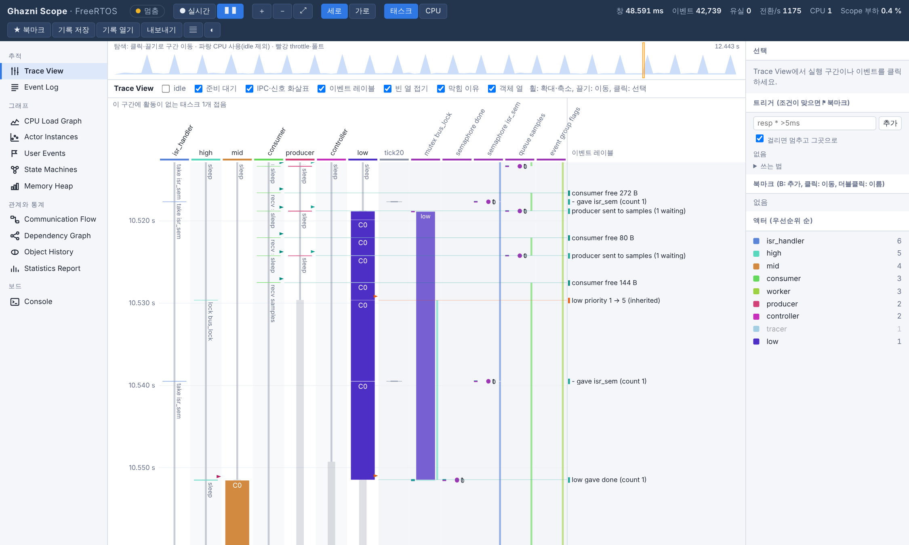

### 3.1 예제에서 일어나는 일

예제(`examples/common/demo.c`)는 화면의 기능이 하나씩 드러나도록 만든 태스크 묶음입니다.

| 태스크 (우선순위) | 하는 일 |
|---|---|
| producer (2) | 큐 `samples`에 값을 보냄. 가끔 1 ms 간격으로 몰아서 보내 큐가 참 |
| consumer (3) | 큐에서 받아 메모리를 잠깐 할당했다 해제 |
| low (1), mid (4), high (5) | 500 ms마다 우선순위 역전: low가 mutex `bus_lock`을 잡은 채 30 ms 일하는 동안 high가 같은 mutex를 원함 |
| controller (2), worker (3) | controller가 상태 기계를 돌며 이벤트 그룹 `flags`로 worker를 깨움 |
| isr_handler (6) | 20 ms마다 오는 인터럽트 `tick20`이 주는 세마포어 `isr_sem`을 기다림 |

### 3.2 처음에 해 볼 것

1. **Space**를 눌러 화면을 멈춥니다.
2. 마우스 **휠**로 확대해서 막대 하나가 보이게 합니다.
3. `low` 열에 긴 막대(30 ms)가 보이는 곳을 찾습니다. 그 옆 `high` 열의 가는 선에 `lock bus_lock`이라고 쓰여 있으면, high가 mutex를 기다리는 중입니다.
4. 오른쪽 레이블 열에서 `low priority 1 → 5 (inherited)`를 찾습니다. low가 high의 우선순위를 물려받은 순간입니다.
5. 왼쪽 메뉴에서 **Statistics Report**를 눌러 태스크별 숫자를 봅니다.

이 장면을 자세히 읽는 법은 [7.1절](#71-높은-우선순위-태스크가-늦다-우선순위-역전)에 있습니다.

### 3.3 다른 예제

| 명령 | 무엇 | 필요한 것 |
|---|---|---|
| `make demo` | FreeRTOS를 Linux 프로세스로 | gcc |
| `make demo-m3` | Cortex-M3 (QEMU의 ARM MPS2 보드), UART | clang, lld, qemu-system-arm |
| `make -C examples/freertos-mps2 run-rtt` | 같은 것을 디버그 프로브(RTT) 방식으로 | 위와 같음 |
| `make -C examples/esp-idf run` | ESP32, CPU 2개 (Espressif의 QEMU) | ESP-IDF 또는 Docker |

---

## 4. 타깃에 붙이기

### 4.1 FreeRTOS

자세한 단계는 [FREERTOS.md](FREERTOS.md)에 있고, 요약하면 네 가지입니다.

1. `targets/freertos/scope_freertos.c`를 빌드에 넣고, `include/`와 `targets/freertos/`를 인클루드 경로에 넣습니다.
2. `FreeRTOSConfig.h` **맨 끝**에:
   ```c
   #define configUSE_TRACE_FACILITY            1
   #define configRECORD_STACK_HIGH_ADDRESS     1
   #define INCLUDE_xTaskGetCurrentTaskHandle   1
   #define INCLUDE_xTaskGetSchedulerState      1
   #define INCLUDE_xTaskDelayUntil             1
   #define INCLUDE_uxTaskGetStackHighWaterMark 1
   #define configQUEUE_REGISTRY_SIZE           16
   #include "scope_freertos.h"
   ```
3. 보드에 맞는 함수 세 개(`scope_port.h`):
   ```c
   uint64_t scope_port_time(void);                       /* 계속 늘어나는 시각 (예: DWT 사이클 카운터) */
   uint64_t scope_port_hz(void);                         /* 그 주파수 */
   void scope_port_write(const uint8_t *buf, size_t n);  /* PC로 보내기 (UART, RTT ...) */
   ```
4. `vTaskStartScheduler()` 전에 `scope_init()`.

이름을 붙이면 화면이 훨씬 읽기 쉬워집니다.

```c
vQueueAddToRegistry(rx_queue, "rx_queue");   /* 큐, 세마포어, mutex */
scope_name_object(events, "events");          /* 이벤트 그룹 */
scope_isr_name(1, "uart_rx");                 /* 인터럽트 */

void USART2_IRQHandler(void)
{
    scope_isr_begin(1);                       /* 인터럽트 처리 시간을 재려면 처음과 끝에 */
    /* ... */
    scope_isr_end(1);
}
```

### 4.2 ESP32 (ESP-IDF)

프로젝트의 `CMakeLists.txt`에 한 줄, `sdkconfig.defaults`에 몇 줄이면 됩니다. [ESP-IDF.md](ESP-IDF.md)를 보세요.

### 4.3 PC에서 받는 방법

| 타깃이 바이트를 내보내는 곳 | 명령 |
|---|---|
| UART (USB-시리얼 어댑터) | `ghazni-scope --serial /dev/ttyUSB0 --baud 921600` (Windows는 `COM5`) |
| 디버그 프로브: J-Link의 RTT 서버 | `ghazni-scope --tcp localhost:19021` |
| 디버그 프로브: OpenOCD의 RTT 서버 | `ghazni-scope --tcp localhost:9090` ([RTT.md](RTT.md)) |
| 디버그 프로브: 아무 GDB 서버 | `ghazni-scope --rtt-gdb localhost:3333 --elf app.elf` |
| 표준 출력으로 내보내는 프로그램 | `ghazni-scope --exec "프로그램 인자"` |
| TCP로 바이트를 주는 곳 | `ghazni-scope --tcp 호스트:포트` |
| 저장한 기록 파일 | `ghazni-scope --replay 파일` |

그다음 브라우저로 <http://localhost:8800>을 엽니다. 포트를 바꾸려면 `--port 8900`.

> **UART를 printf와 같이 써도 되나요?** 됩니다. 프레임은 `0x01 … 0x00`으로 감싸여 있어 도구가 콘솔 글과 구분합니다. 콘솔 글은 Console 화면과 터미널에 나옵니다. 다만 다른 태스크의 printf가 **프레임 중간에 끼어들지 않게** UART를 mutex로 나눠 쓰세요.

---

## 5. 화면 둘러보기

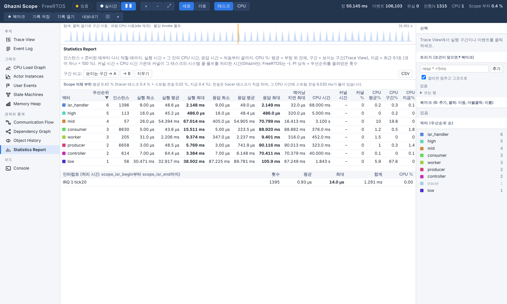

### 5.1 화면의 부분

| 부분 | 내용 |
|---|---|
| 맨 위 막대 | 제목 옆 OS 이름(`· FreeRTOS`), 멈춤/실시간, 확대·축소·전체, 세로/가로, 열 = 태스크/CPU, 그리고 오른쪽에 **창**(보이는 구간 길이), **이벤트** 수, **유실**, 초당 전환, CPU 수, **Scope 부하** |
| 둘째 줄 | 북마크, 기록 저장·열기, 내보내기(Perfetto), 메뉴·오른쪽 패널 접기, 밝게/어둡게(◐), 언어(EN/한국어) |
| 탐색 막대 | 기록 전체의 CPU 사용 그래프. 클릭·끌기로 그 시점으로 이동. 노란 상자 = 지금 보이는 구간 |
| 왼쪽 | 화면 목록 |
| 가운데 | 고른 화면 |
| 오른쪽 | **선택**(클릭한 것의 자세한 정보), **트리거**, **북마크**, **액터 목록**(클릭하면 그 태스크를 숨김/보임) |

### 5.2 조작

| 하고 싶은 것 | 방법 |
|---|---|
| 멈춤 / 실시간 | **Space**, 또는 `❚❚` / `● 실시간` |
| 확대 / 축소 | 마우스 **휠**, **+** / **−** |
| 시간축으로 옮기기 | **끌기**, 또는 **Shift + 휠** |
| 기록 전체 보기 | **F**, 또는 `⤢` |
| 정보 보기 | 막대·선·깃발 위에 **마우스를 올림**(풍선 도움말), **클릭**(오른쪽 '선택'에 자세히) |
| 북마크 | **B** (선택한 시각, 없으면 보이는 구간 가운데) |
| 태스크 숨기기 | 오른쪽 액터 목록에서 이름 클릭 |
| 다른 화면에서 Trace View로 | 표의 줄, 그래프의 점을 클릭 |

### 5.3 언어, 테마, 설정 저장

- **언어**: 처음에는 브라우저 언어를 따릅니다(한국어 브라우저면 한국어, 아니면 영어). 오른쪽 위 `EN` / `한국어` 단추로 바꿉니다. 이벤트 레이블("producer sent to samples")은 두 언어 모두 영어입니다.
- **테마**: `◐`로 밝게/어둡게.
- 체크 상자, 숨긴 태스크, 세로·가로, 테마, 언어, 북마크는 브라우저에 저장되어 다음에 열어도 그대로입니다.

---

## 6. 화면별 사용법

각 화면을 "무엇을 보여 주나 / 어떻게 읽나 / 언제 쓰나"로 정리했습니다. 더 자세한 설명은 [GUIDE.md](GUIDE.md)에 있습니다.

### 6.1 Trace View — 시점마다 무슨 일이 있었나


**무엇을**: 태스크마다 세로 열 하나. 시간은 위에서 아래로 흐릅니다.

**어떻게 읽나**

| 보이는 것 | 뜻 |
|---|---|
| 색 막대 (안에 `C0`, `C1`) | 태스크가 그 CPU에서 실행됨 |
| 옅은 회색 띠 | 준비됐지만 CPU를 기다림(더 높은 우선순위가 돌고 있음) |
| 가운데 가는 선 + 세로 글 | 멈춰 있었고, 무엇을 기다렸는지: `recv samples`(큐가 빔), `send → samples`(큐가 가득), `lock bus_lock`(mutex), `take isr_sem`(세마포어), `wait flags`(이벤트 그룹), `sleep`(vTaskDelay) |
| 작은 삼각형 | 누가 누구를 깨웠나 |
| 인터럽트 열 (`tick20`) | 인터럽트 처리 구간 |
| 객체 열 (`mutex bus_lock` 등) | mutex는 잡고 있던 태스크의 색 막대, 큐·세마포어는 주고받은 순간의 개수 |
| 오른쪽 이벤트 레이블 | 그 시점의 일을 글로 |

**체크 상자**: idle(CPU가 쉰 시간), 준비 대기, 화살표, 이벤트 레이블, 빈 열 접기(보이는 구간에 아무 일도 없던 태스크를 접음), 막힘 이유, 객체 열.

**보기 바꾸기**: `가로`(시간이 왼쪽→오른쪽), `CPU`(열 = CPU: 어느 CPU가 무엇을 돌렸나).

**언제 쓰나**: 거의 항상. 다른 화면에서 이상한 점을 찾으면 클릭해서 여기로 와서 그 순간을 봅니다.

### 6.2 Event Log — 모든 이벤트를 표로

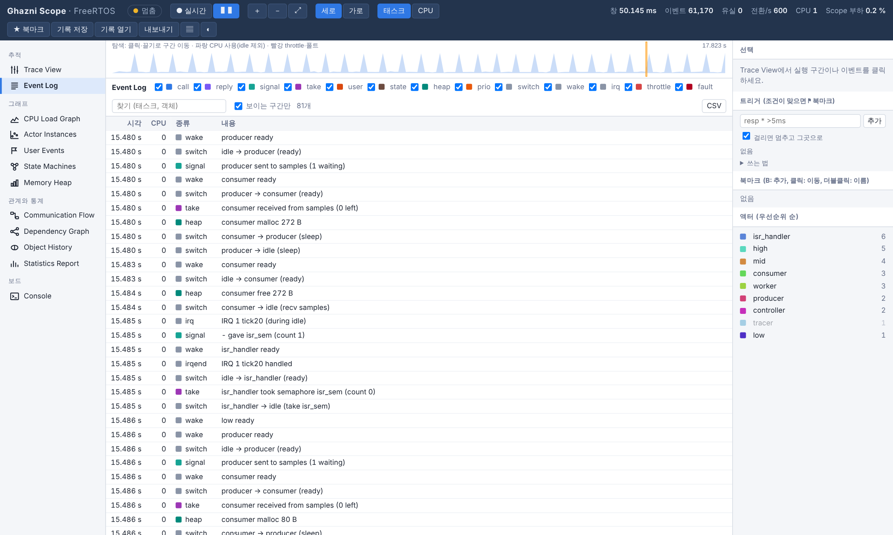

모든 이벤트를 시간순으로 봅니다. 위에서 **종류별로 거르고**(예: signal만), **글로 찾고**(예: `bus_lock`), 줄을 클릭하면 Trace View의 그 순간으로 갑니다. '보이는 구간만'을 끄면 기록 전체. **CSV**로 받을 수 있습니다.

### 6.3 CPU Load Graph — 누가 CPU를 썼나

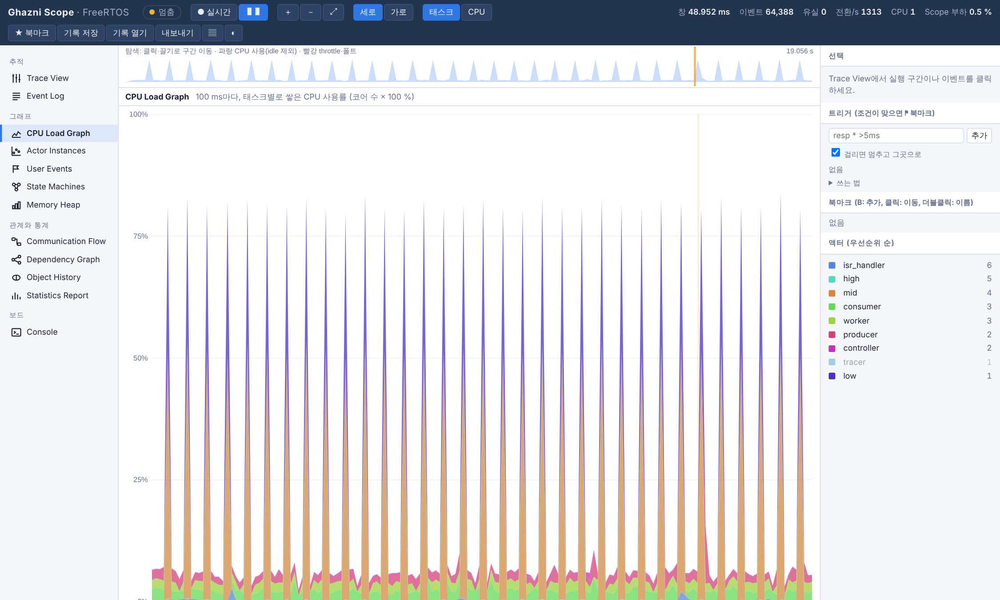

100 ms마다 태스크별 CPU 사용률을 쌓은 그래프. 높이 = CPU 사용률(CPU 2개면 200 %까지). **언제**: 시스템이 바쁜 때와 그때 범인을 찾을 때.

### 6.4 Actor Instances — 한 번 일할 때 얼마나 걸리나

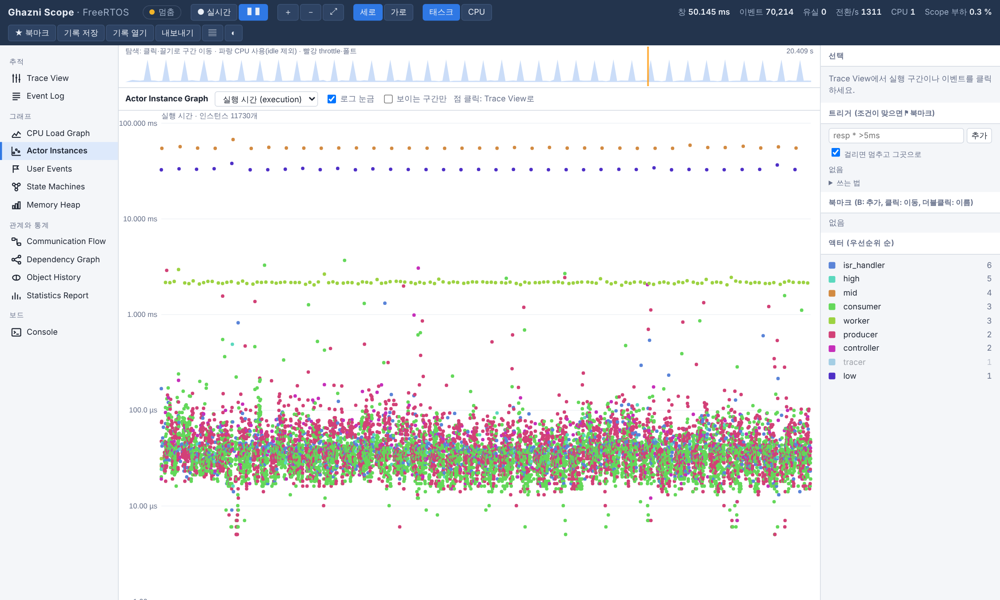

**인스턴스** = 태스크가 깨어나서(준비) 일하고 다시 멈출 때까지 한 번. 인스턴스마다 점 하나.
- **실행 시간**: 그 안에서 CPU를 실제로 쓴 시간.
- **응답 시간**: 깨어난 때부터 멈출 때까지 전체(기다린 시간 포함).

위쪽 선택 상자로 둘을 바꿉니다. **로그 눈금**이 기본입니다. **위로 튄 점**이 "가끔 오래 걸린 때"이고, 클릭하면 그 순간의 Trace View로 갑니다.

### 6.5 User Events — 내 코드가 남긴 값과 글

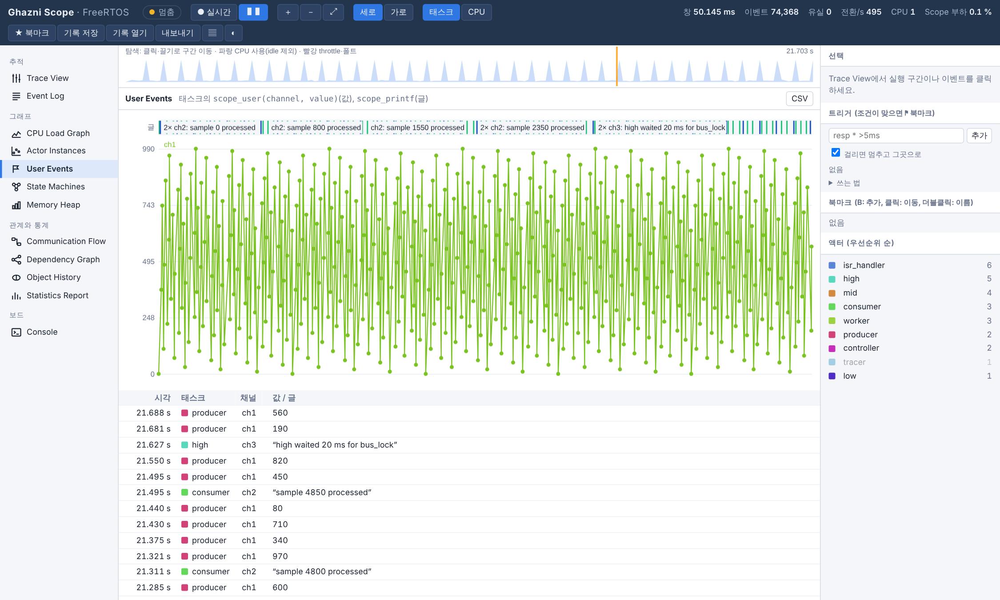

`scope_user(채널, 값)`의 값이 채널마다 그래프로, `scope_printf`의 글이 위쪽 띠와 아래 표로 나옵니다. [9장](#9-사용자-이벤트-내-코드의-값과-상태-보기) 참고.

### 6.6 State Machines — 상태가 언제 바뀌었나

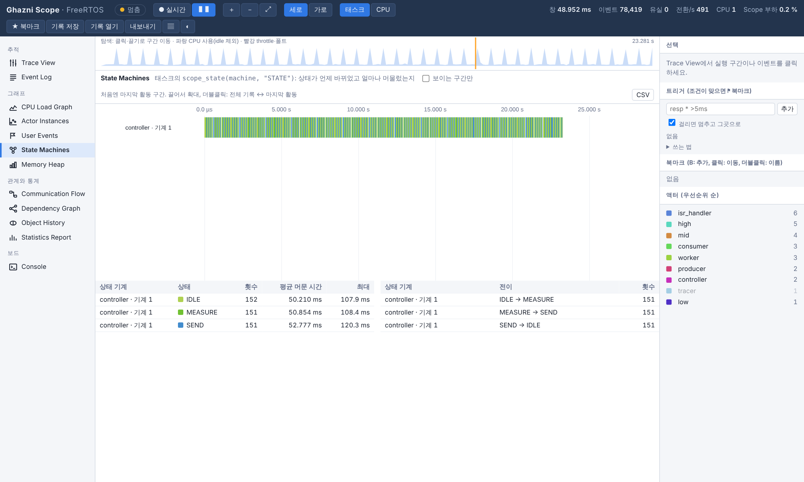

`scope_state(기계, "상태")`로 알린 상태의 타임라인, 상태마다 머문 시간(횟수·평균·최대), 전이 횟수. 끌어서 확대, 더블클릭으로 전체 기록 ↔ 마지막 활동.

### 6.7 Memory Heap — 메모리를 누가 얼마나

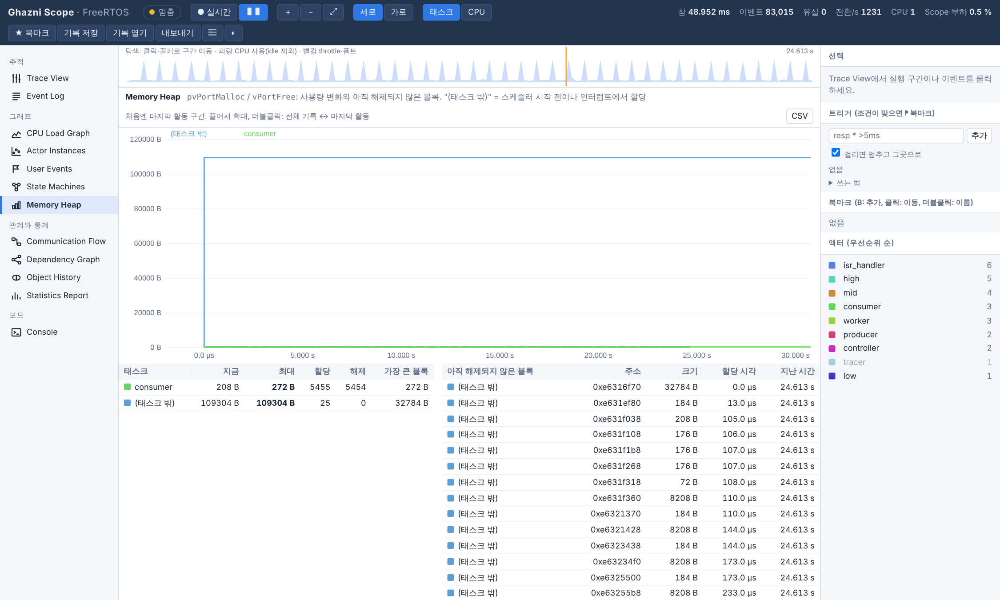

- 그래프: 태스크별 힙 사용량 변화.
- 왼쪽 표: 태스크마다 지금·최대·할당 수·해제 수·가장 큰 블록.
- 오른쪽 표: **아직 해제되지 않은 블록**(주소, 크기, 할당 시각, 지난 시간). 누수를 찾을 때 봅니다.
- 경고: 해제되지 않은 주소에 다시 할당, 모르는 블록 해제.
- "(태스크 밖)": 스케줄러 시작 전이나 인터럽트에서 한 할당(대개 태스크 스택과 큐). 크고 변하지 않아서 그래프에서는 기본으로 뺍니다(체크 상자).

### 6.8 Communication Flow — 누가 누구에게

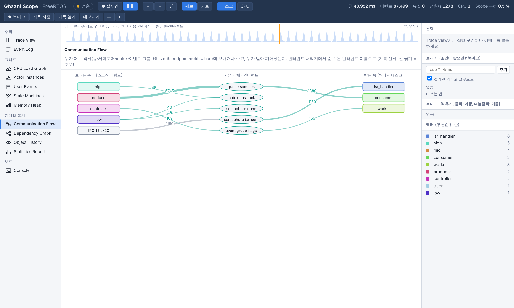

왼쪽 = 보낸 쪽(태스크, 인터럽트), 가운데 = 객체(큐·세마포어·mutex·이벤트 그룹), 오른쪽 = 그것을 기다리다 깨어난 태스크. 선 굵기와 숫자 = 횟수(기록 전체). 시스템의 구조를 한눈에 확인할 때 씁니다.

### 6.9 Dependency Graph — 태스크 사이의 관계만

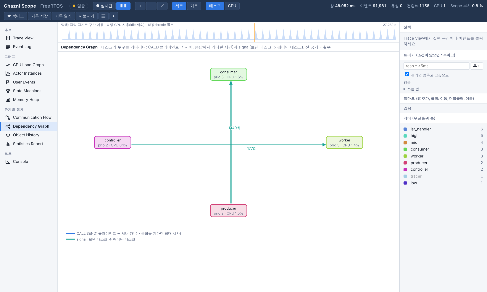

객체를 빼고 "누가 누구를 깨우나"만 간추린 그림입니다.

### 6.10 Object History — 객체 하나의 일생

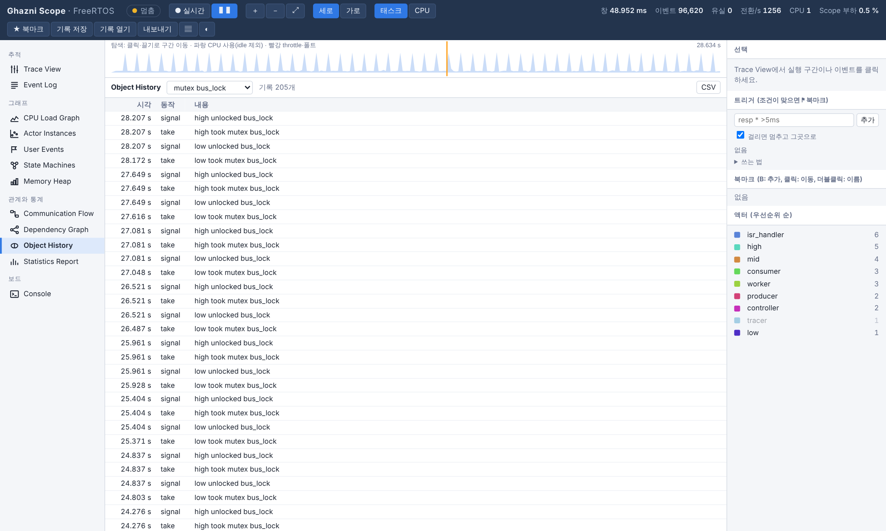

큐·세마포어·mutex 하나를 골라 그것에 일어난 일(보냄·줌, 받음·가져감, 그때의 개수)을 시간순으로 봅니다. "이 mutex를 누가 너무 오래 잡나?"를 볼 때.

### 6.11 Statistics Report — 숫자로 요약


태스크마다:

| 열 | 뜻 |
|---|---|
| 인스턴스 | 깨어나 일하고 멈춘 횟수 |
| 실행 최소·평균·최대 | 한 번 일할 때 CPU를 쓴 시간 |
| 응답 최소·평균·최대 | 깨어나서 끝날 때까지 |
| 깨어남 지연 최대 | 준비된 뒤 CPU를 받기까지 가장 오래 기다린 시간 |
| CPU 시간, CPU 평균% / 구간% / 지금% | 처음부터 / 보이는 구간 / 최근 0.1초 (CPU 하나 = 100 %) |
| PI 상속 | 우선순위를 물려받은 횟수 |
| 스택 | 쓴 양 / 크기 (%) |

아래에는 **인터럽트**마다 횟수·평균·최대·합계·CPU %, 맨 위에는 **Scope 자체 부하**.

**구간 비교**: Trace View에서 한 구간을 보고 `보이는 구간 → A`, 다른 구간을 보고 `→ B`를 누르면 두 구간을 나란히 비교합니다.

### 6.12 Console — 타깃의 콘솔

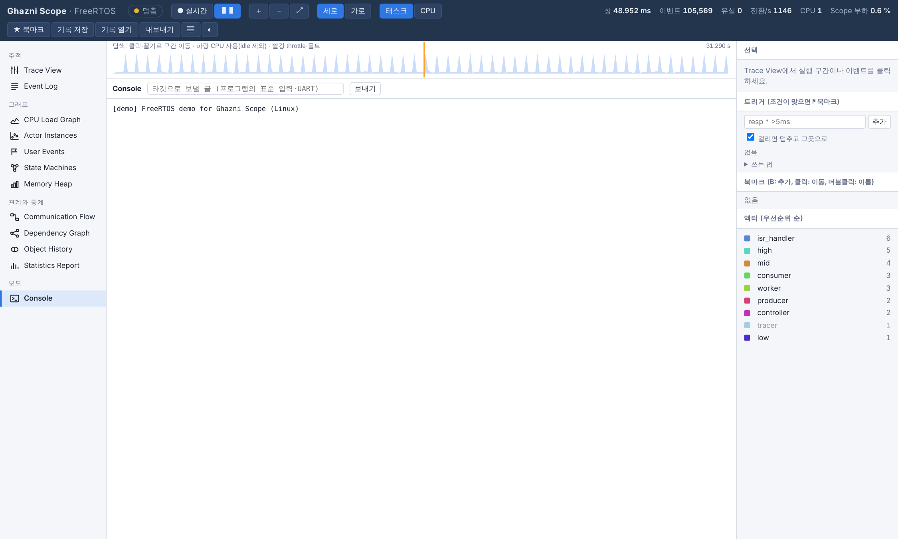

프레임 사이에 섞여 온 타깃의 글(printf, 로그)이 나옵니다. 아래 입력 칸에 쓴 글은 타깃으로 보냅니다(UART, 또는 `--exec` 프로그램의 표준 입력).

---

## 7. 문제 찾기: 사례로 배우기

예제(`make demo`)에서 실제로 볼 수 있는 장면으로, 흔한 문제를 찾는 순서를 보여 줍니다.

### 7.1 높은 우선순위 태스크가 늦다 (우선순위 역전)

**증상**: high(우선순위 5)가 일을 시작하기까지 가끔 20 ms 넘게 걸립니다. 예제에서는 high가 직접 `high waited 20 ms for bus_lock`이라고 남깁니다(User Events).

**찾는 법**
1. Trace View에서 high 열을 따라가면 `lock bus_lock`이라고 쓰인 긴 가는 선이 있습니다. high가 mutex를 기다리며 막혀 있던 구간이고, 선 위에 마우스를 올리면 그 길이가 나옵니다.
2. `mutex bus_lock` 객체 열을 보면, 그동안 low가 잡고 있었습니다(low 색 막대).
3. 레이블에 `low priority 1 → 5 (inherited)`: FreeRTOS가 우선순위 상속으로 low를 올려 줬습니다. 그래서 그 사이에 깨어난 mid(4)가 low를 밀어내지 못하고, low가 빨리 끝내고 mutex를 풉니다.
4. Object History에서 `mutex bus_lock`을 고르면 누가 언제 잡고 풀었는지 시간순으로 나옵니다.

> **Actor Instances나 Statistics의 응답 시간에는 이 기다림이 안 보입니다.** 인스턴스는 태스크가 막히면 끝나기 때문입니다. high는 "깨어남 → mutex에서 막힘"(짧음)과 "mutex를 얻음 → 일 → 잠"(짧음)의 두 인스턴스로 나뉩니다. 막혀서 기다린 시간은 Trace View의 막힘 선, Object History, 그리고 직접 남긴 값(`scope_printf`, `scope_user`)으로 봅니다. 반대로 CPU를 기다린 시간(옅은 회색 띠)은 응답 시간에 들어갑니다(7.3절).


**해석**: high가 기다린 시간 = low가 mutex를 잡고 한 일의 길이(30 ms). 상속 덕분에 mid의 50 ms만큼 더 늘어나지는 않았습니다. 줄이려면 mutex를 잡은 채로 하는 일을 짧게 해야 합니다.

### 7.2 큐가 가득 차서 보내는 쪽이 멈춘다

**찾는 법**: Object History에서 큐를 고르면 "(n waiting)"이 커지는 게 보입니다. Trace View의 `queue samples` 열에서 개수가 쌓이고, 보내는 태스크에 `send → samples` 선이 생기면 큐가 가득 차 멈춘 것입니다.

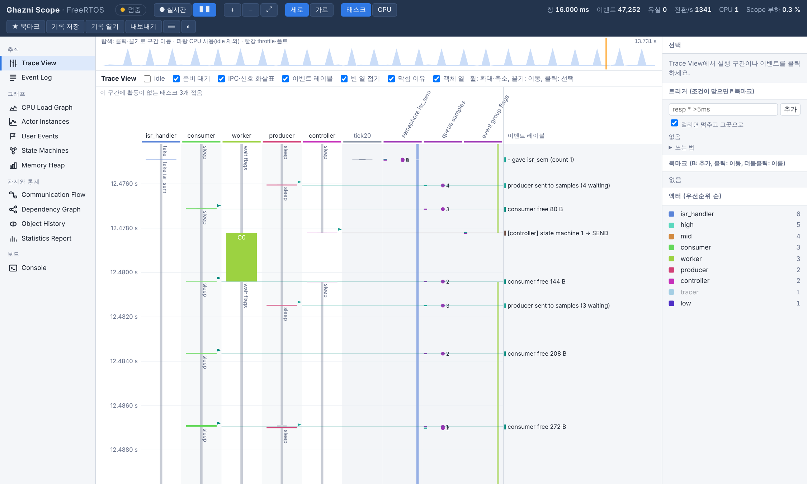

**해석**: 받는 쪽(consumer)이 보내는 쪽보다 느립니다. 받는 태스크의 Statistics(실행 시간, 깨어남 지연)를 보고, 우선순위를 올리거나 일을 줄이거나 큐를 키웁니다.

### 7.3 드물게 생기는 지연을 잡기 (조건 트리거)

몇 분에 한 번 생기는 지연은 화면을 보고 있다가 잡기 어렵습니다. **트리거**를 걸어 두면 도구가 모든 이벤트를 확인하다가 조건이 맞는 순간 북마크를 남기고 화면을 그곳에 멈춥니다.

1. 오른쪽 '트리거' 칸에 `resp consumer >5ms`를 쓰고 `추가`.
2. '걸리면 멈추고 그곳으로'를 켜 둡니다.
3. 기다립니다. 걸리면 ⚑ 북마크가 생기고 화면이 그 순간으로 갑니다.

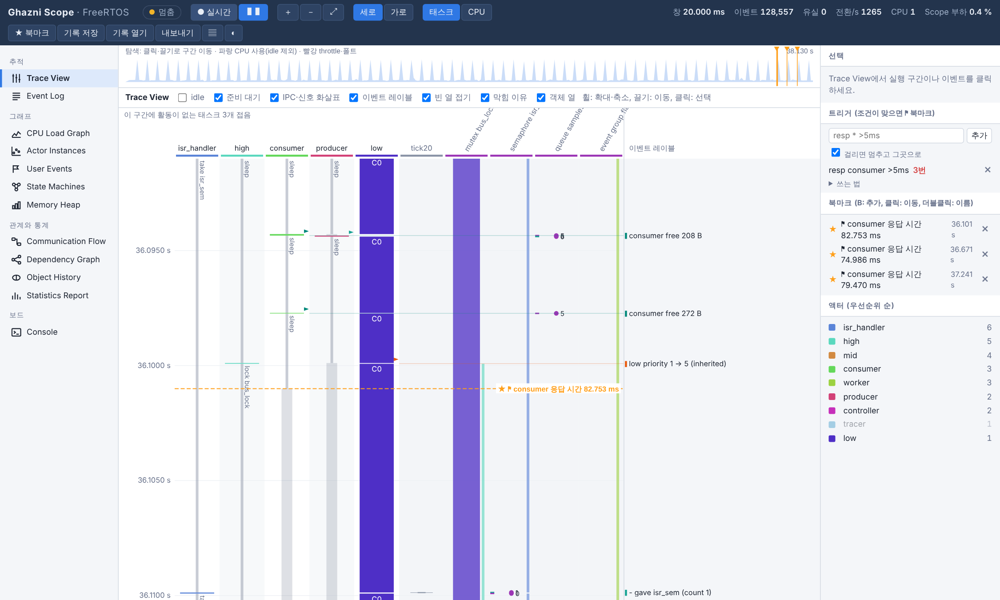

위 그림에서 consumer의 응답이 수십 ms가 된 이유가 보입니다. 우선순위를 물려받은 low(5)가 도는 동안 consumer(3)는 옅은 회색 띠(CPU를 기다림)로 있었습니다.

| 조건 | 뜻 |
|---|---|
| `resp 태스크 >5ms` | 응답 시간이 5 ms를 넘음 (`*` = 아무 태스크) |
| `exec * >1ms` | 실행 시간이 1 ms를 넘음 |
| `lat high >200us` | 깨어난 뒤 CPU를 받기까지 200 µs를 넘음 |
| `isr tick20 >50us` | 인터럽트 처리 시간 (이름이나 번호) |
| `user 1 >900`, `user 1 <10` | 사용자 이벤트 채널 1의 값 |
| `state 1 SEND` | 상태 기계 1이 SEND에 들어감 |
| `heap` | 힙 경고 |

시간에는 단위(`s`, `ms`, `us`)를 붙입니다. 명령줄에서도 됩니다: `--trigger "resp consumer >5ms"`(여러 번 줄 수 있음).

### 7.4 인터럽트가 오래 걸린다

Statistics Report 아래의 인터럽트 표에서 **최대**를 봅니다. Trace View의 인터럽트 열에서 막대에 마우스를 올리면 처리 시간이 나옵니다. 트리거 `isr 이름 >50us`로 긴 것만 잡을 수 있습니다. 인터럽트 처리기에서 오래 걸리는 일은 태스크로 넘기세요(세마포어를 주고, 태스크가 처리).

### 7.5 메모리가 조금씩 샌다

Memory Heap의 **아직 해제되지 않은 블록** 표를 '지난 시간' 순으로 봅니다. 오래 남아 있는 블록, 계속 늘어나는 태스크의 '지금' 값이 의심 대상입니다. 블록을 클릭하면 할당한 순간의 Trace View로 갑니다.

### 7.6 시스템이 너무 바쁘다

CPU Load Graph에서 높은 구간을 찾고, 그 구간을 Trace View로 본 뒤 Statistics Report의 'CPU 구간%'로 범인을 찾습니다. 평소 구간을 A, 바쁜 구간을 B로 **구간 비교**하면 무엇이 달라졌는지 바로 보입니다.

---

## 8. 기록하고 나누기

| 하고 싶은 것 | 방법 |
|---|---|
| 지금까지 받은 것을 파일로 | `기록 저장` 단추(`.gzscope`, 최대 256 MB) 또는 `--record raw.bin` |
| 저장한 것을 다시 보기 | `기록 열기` 단추, 또는 `ghazni-scope --replay 파일` |
| 표를 엑셀로 | 각 화면의 `CSV` 단추 (한글이 깨지지 않게 BOM 포함) |
| 다른 도구로 | `내보내기`(Perfetto JSON) → <https://ui.perfetto.dev>에서 열기. 또는 `--perfetto out.json` |
| 중요한 순간 표시 | **B**로 북마크, 오른쪽 목록에서 더블클릭해 이름 붙이기 |

기록 파일을 동료에게 보내면 보드 없이도 똑같은 화면을 볼 수 있습니다. 기록을 열었을 때 지금 걸어 둔 트리거도 파일 전체에서 다시 확인합니다.

---

## 9. 사용자 이벤트: 내 코드의 값과 상태 보기

RTOS 이벤트만으로는 알 수 없는 것(센서 값, 처리한 개수, 내 프로그램의 상태)을 직접 남길 수 있습니다.

```c
scope_user(1, adc_value);                            /* User Events: 채널 1의 그래프 */
scope_printf(2, "packet %u: %d bytes", id, len);     /* User Events: 글 (%d %u %x %s %c, 127자까지) */
scope_print(2, "calibration done");                  /* 서식 없는 글 */
scope_state(1, "MEASURE");                           /* State Machines: 상태 기계 1이 MEASURE로 */
```

- 채널은 0~255, 상태 기계는 0~63입니다.
- 모두 태스크에서 부르세요. 인터럽트에서도 동작하지만 글은 4바이트마다 이벤트 하나를 쓰므로 짧게.
- 값이 특정 범위를 벗어나는 순간을 잡으려면 트리거 `user 1 >900`.

---

## 10. 숫자를 얼마나 믿을 수 있나

- **유실 0**이면 타깃이 기록한 이벤트를 모두 받았습니다. 0이 아니면 그 근처의 실행 막대·막힘 정보가 틀릴 수 있습니다. 줄이려면 UART를 빠르게, 링을 크게(`-DSCOPE_RING_EVENTS`), tracer의 우선순위를 높게(`-DSCOPE_TASK_PRIO`) 하거나 RTT를 쓰세요.
- **시각**은 타깃의 타이머(`scope_port_time`)로 잰 것이라 PC가 받은 시각과 무관합니다. 정밀도는 그 타이머의 눈금입니다(DWT면 CPU 클럭, ESP32는 1 µs).
- **Scope 부하**는 Scope 때문에 타깃이 쓴 CPU입니다(tracer 태스크 + 보내기). 다른 태스크의 숫자는 그만큼 나쁘게 보일 수 있습니다. 보통 1 % 안팎이고, UART 드라이버를 쓰는 ESP32는 더 큽니다.
- **에뮬레이터(QEMU, Linux의 FreeRTOS)의 시간 숫자**는 참고만 하세요. QEMU는 실제 칩의 속도를 흉내 내지 않고, Linux 위의 FreeRTOS는 Linux 스케줄러 때문에 가끔 튑니다. 성능 숫자는 실제 보드에서 보세요.
- **이벤트 순서**: CPU가 여럿이면 CPU마다 따로 기록하고 tracer가 시각순으로 합칩니다. 그래서 최근 20 ms는 한 차례 늦게 보입니다.

---

## 11. 문제 해결

| 증상 | 확인할 것 |
|---|---|
| `ghazni-scope: command not found` | `pipx ensurepath` 후 터미널을 새로 열었는지 |
| `--serial needs pyserial` | `pipx inject ghazni-scope pyserial` |
| 화면이 "스트림을 기다리는 중…"에서 안 바뀜 | 연결(포트, baud)이 맞는지, 타깃에서 `scope_init()`을 불렀는지, tracer 태스크가 CPU를 받는지(더 높은 우선순위 태스크가 CPU를 놓지 않으면 못 돎) |
| 터미널에 깨진 글자 | baud가 양쪽에서 같은지 |
| 유실이 계속 늘어남 | [10장](#10-숫자를-얼마나-믿을-수-있나)의 대역폭·링 크기·우선순위 |
| 큐·세마포어 이름이 `q0`, `sem3` | `vQueueAddToRegistry`와 `configQUEUE_REGISTRY_SIZE` > 0 (ESP-IDF는 `CONFIG_FREERTOS_QUEUE_REGISTRY_SIZE`) |
| 이벤트 그룹 이름이 `grp4` | `scope_name_object(핸들, "이름")` |
| 인터럽트 열이 없음 | 처리기에 `scope_isr_begin/end`를 넣었는지 |
| Memory Heap이 비어 있음 | FreeRTOS의 `pvPortMalloc`를 쓰는지(heap_1~5). ESP-IDF는 `CONFIG_HEAP_USE_HOOKS=y` |
| 스택 열이 0 | `configRECORD_STACK_HIGH_ADDRESS 1`, `INCLUDE_uxTaskGetStackHighWaterMark 1` |
| 빌드 오류 `needs configUSE_TRACE_FACILITY 1` | FreeRTOSConfig.h에 그 줄, 그리고 `#include "scope_freertos.h"`가 맨 끝인지 |
| `traceXXX redefined` 경고 | 다른 트레이서(Tracealyzer, SystemView)나 직접 정의한 trace 매크로와 겹침. 하나만 쓰세요 |
| 포트 8800이 이미 쓰임 | `--port 8900` |
| 화면이 느림 | 확대해서 보는 구간을 줄이기(이벤트가 3만 개를 넘는 구간은 레이블을 숨김), 오래 켜 두었다면 페이지를 새로 고침 |

---

## 12. 명령줄 옵션 전체

```
ghazni-scope [연결 하나] [옵션 ...]
```

**연결** (하나를 고름)

| 옵션 | 뜻 |
|---|---|
| `--serial 장치 [--baud 속도]` | 시리얼 포트 (기본 1500000 baud: Ghazni 기준, FreeRTOS 예제는 921600) |
| `--tcp 호스트:포트` | TCP로 바이트를 받음 (QEMU, ser2net, J-Link·OpenOCD의 RTT 서버) |
| `--rtt-gdb 호스트:포트` | GDB 서버로 RTT 버퍼를 읽음. `--elf 앱.elf` 또는 `--rtt-addr 0x20000008`, `--rtt-channel 이름|번호`(기본 Scope), `--rtt-poll 밀리초`(기본 10) |
| `--exec "명령"` | 그 프로그램의 표준 출력을 받음 |
| `--replay 파일` | 저장한 기록을 봄 |
| `--qemu ELF [--smp N]`, `--net 주소` 등 | Ghazni 전용 (Ghazni 문서) |

**그 밖에**

| 옵션 | 뜻 |
|---|---|
| `--port 8800` | 웹 화면 포트 |
| `--record 파일` | 받은 바이트를 그대로 저장 |
| `--perfetto 파일.json` | 끝날 때 Perfetto 형식으로 저장 |
| `--trigger "조건"` | 조건 트리거 (여러 번) |
| `--check 초` | 브라우저 없이 그 시간만큼 받고 요약을 출력하고 끝냄 (`SCOPE_JSON=파일`을 주면 요약을 JSON으로). 자동 시험용 |
| `--quiet` | 콘솔 글을 터미널에 찍지 않음 |
| `--version` | 버전 |

`--check`의 출력 예:
```
scope: 10657 events, 0 lost, 326 frames, 3488 run segments, 1 CPU(s), 10 tasks
  producer    runs    862  cpu   1.3 %  max slice    2.489 ms  max wake latency   77.420 ms  throttles 0
  ...
```

---

## 13. 용어

| 용어 | 뜻 |
|---|---|
| 태스크 (액터) | RTOS가 돌리는 실행 단위. 화면에서는 '액터'라고도 함 |
| 실행 구간 | 태스크가 CPU를 잡고 돈 연속된 시간 |
| 준비 대기 | 돌 준비가 됐지만 CPU가 없어 기다리는 상태 (옅은 회색 띠) |
| 막힘 | 무언가(큐, 세마포어, mutex, 이벤트 그룹, 시간)를 기다려 스스로 멈춘 상태 |
| 인스턴스 | 깨어나서 일하고 다시 막힐 때까지 한 번 |
| 실행 시간 / 응답 시간 | 인스턴스 안에서 CPU를 쓴 시간 / 인스턴스 전체 길이 |
| 깨어남 지연 | 준비된 순간부터 CPU를 받기까지 |
| 우선순위 역전 | 높은 우선순위 태스크가 낮은 우선순위 태스크가 잡은 자원을 기다리는 상황 |
| 우선순위 상속 (PI) | 그때 자원을 잡은 낮은 태스크의 우선순위를 잠시 올려 주는 것 |
| ISR | 인터럽트 처리기 |
| 객체 | 큐, 세마포어, mutex, 이벤트 그룹 |
| 트리거 | 조건이 맞는 순간을 잡아 북마크하는 기능 |
| 유실 | 타깃의 버퍼가 넘쳐 버린 이벤트 수 |
| Scope 부하 | Scope 자신이 타깃에서 쓰는 CPU |
| tracer | 타깃에서 이벤트를 모아 보내는 태스크 (화면에서는 처음에 숨김) |
| RTT | 디버그 프로브가 타깃 RAM을 직접 읽어 데이터를 받는 방식 ([RTT.md](RTT.md)) |
| 프레임 | 스트림의 단위. `0x01`로 시작해 `0x00`으로 끝남 ([PROTOCOL.md](PROTOCOL.md)) |
