# 스크린샷

Ghazni Scope의 대표 화면입니다. 모두 이 저장소의 FreeRTOS 예제(`make demo`: FreeRTOS를 Linux에서 실행)를 실시간으로 받으며 찍었습니다. 화면마다 쓰는 법은 [docs/GUIDE.md](../docs/GUIDE.md)에 있습니다.

예제에서 일어나는 일(자세히는 [docs/FREERTOS.md](../docs/FREERTOS.md) 8절):
- `producer` → 큐 `samples` → `consumer`
- `low`·`mid`·`high`와 mutex `bus_lock`: 매 주기 우선순위 역전과 상속
- `controller` → 이벤트 그룹 `flags` → `worker`
- 20 ms마다 인터럽트 `tick20` → 세마포어 `isr_sem` → `isr_handler`

## Trace View

### 1. 우선순위 역전과 상속
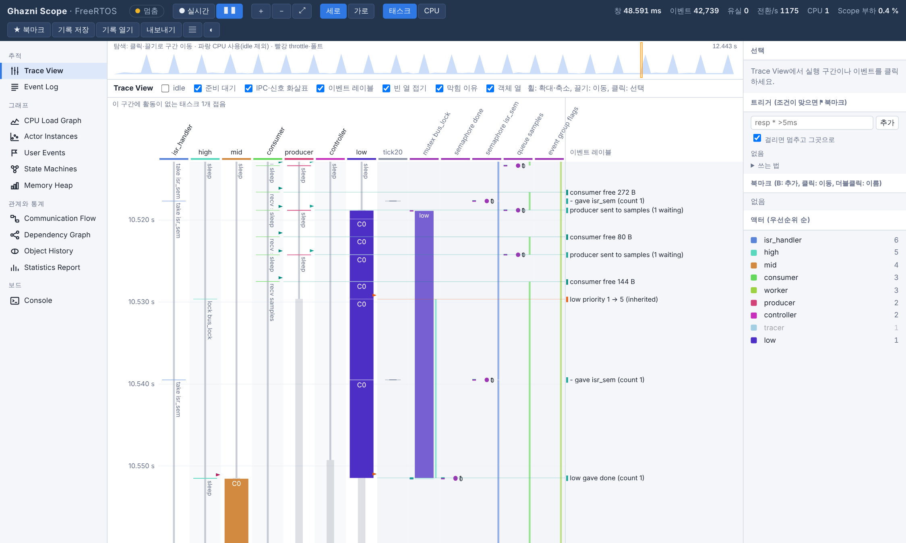

- `high`가 `lock bus_lock`으로 막힙니다.
- mutex를 잡고 있던 `low`의 우선순위가 1 → 5로 오릅니다(오른쪽 레이블 "low priority 1 → 5 (inherited)").
- 가운데 `mutex bus_lock` 열에 `low`가 mutex를 잡은 구간이 보라색 막대로 그려집니다.
- `low`가 mutex를 풀고 나서야 `mid`가 실행됩니다.

### 2. 큐와 이벤트 그룹
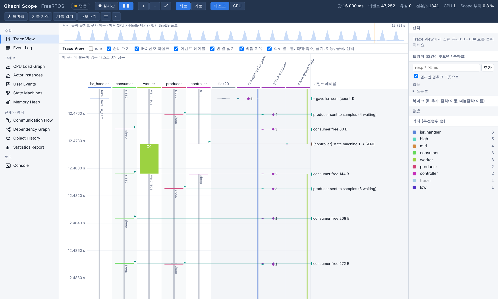

- `producer`가 큐에 보내면 `recv samples`로 막혀 있던 `consumer`가 깨어납니다(화살표).
- `controller`가 상태 SEND에서 비트를 세우면 `wait flags`로 기다리던 `worker`가 일합니다.

### 3. 가로 보기
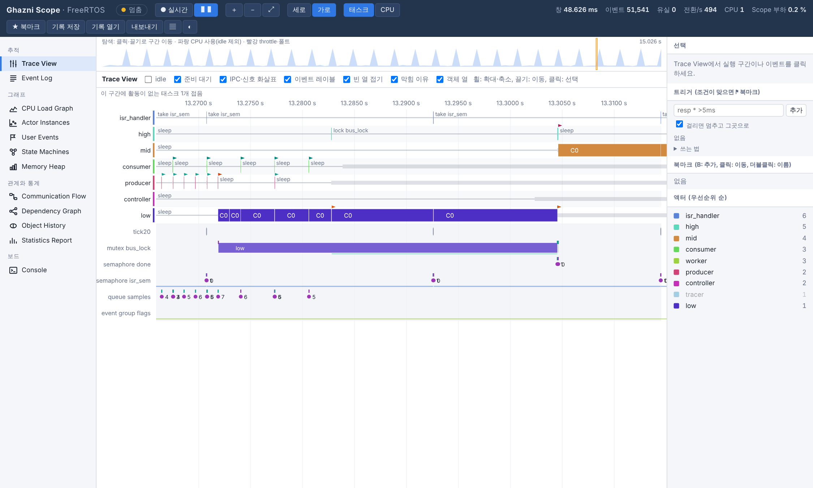

1번과 같은 구간을 가로로 본 것입니다. 시간이 왼쪽에서 오른쪽으로 흐르고, 아래쪽에 인터럽트와 객체(mutex, 세마포어, 큐, 이벤트 그룹)의 줄이 있습니다.

### 4. 넓게 보기 (1초)
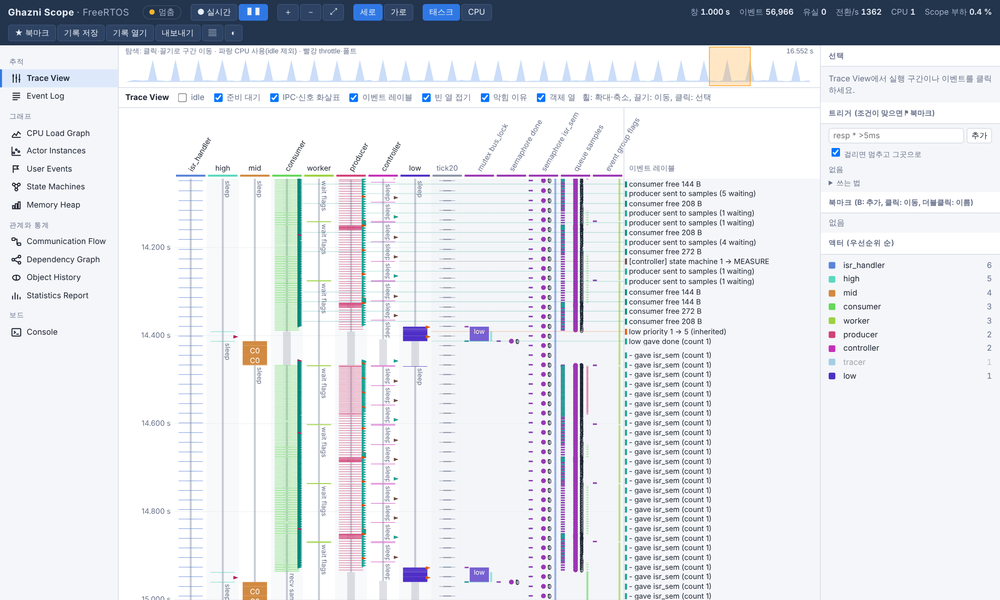

1초 구간입니다. 500 ms마다 반복되는 역전(`low`의 짙은 막대와 mutex 열), 몰아서 보내는 `producer`, 20 ms마다 오는 인터럽트가 한눈에 보입니다. 휠로 확대·축소, 끌어서 이동합니다.

## 그래프

### 5. Event Log
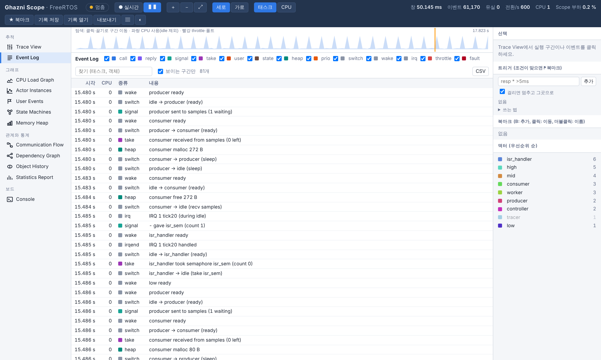

모든 이벤트를 시간순으로 봅니다. 종류별로 거르고 글로 찾을 수 있고, 줄을 클릭하면 Trace View로 갑니다.

### 6. CPU Load Graph
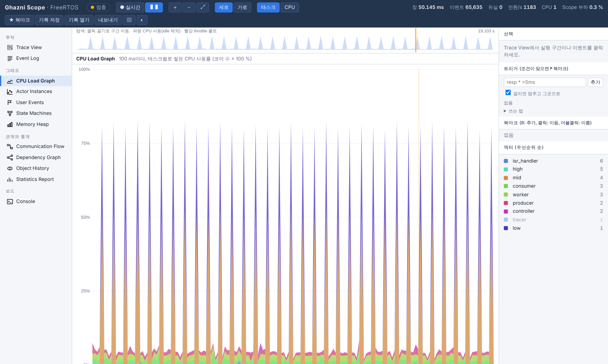

100 ms마다 태스크별 CPU 사용률을 쌓은 그래프입니다. 주기적으로 솟는 것은 `low`(30 ms)와 `mid`(50 ms)가 CPU를 쓰는 때입니다.

### 7. Actor Instances
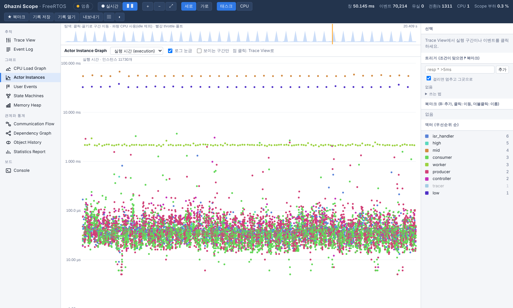

태스크가 한 번 깨어나 일하고 멈출 때까지(인스턴스)마다 실행 시간을 점으로 찍습니다(로그 눈금).

- 위쪽 줄: `mid` 약 50 ms, `low` 약 30 ms.
- 가운데: `worker` 약 2 ms.
- 아래쪽: 짧은 일을 반복하는 `producer`·`consumer`.

점을 클릭하면 그 순간의 Trace View로 갑니다.

### 8. User Events
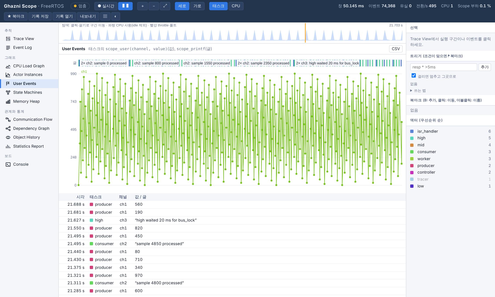

- `scope_user(1, …)`로 남긴 센서 값이 그래프로 나옵니다.
- `scope_printf`로 남긴 글("sample … processed", "high waited 20 ms for bus_lock")은 위쪽 띠와 아래 표에 나옵니다.

### 9. State Machines
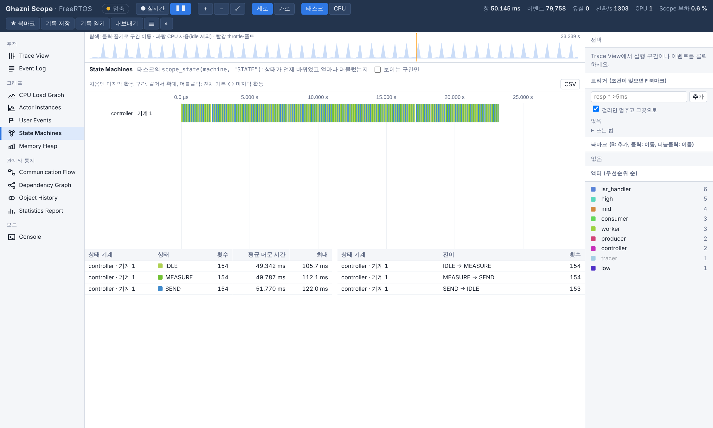

`controller`가 `scope_state`로 알린 상태(IDLE → MEASURE → SEND)의 타임라인입니다. 상태마다 머문 시간과 전이 횟수가 함께 나옵니다.

### 10. Memory Heap
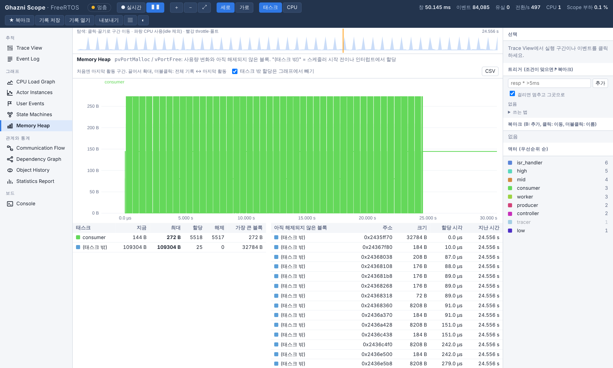

`pvPortMalloc`/`vPortFree` 사용량입니다.

- `consumer`는 수천 번 할당하고 해제했고, 지금 쓰고 있는 블록은 하나입니다(할당 수 = 해제 수 + 1).
- "(태스크 밖)"은 스케줄러 시작 전에 할당된 태스크 스택·큐입니다. 크고 변하지 않아서 그래프에서는 기본으로 뺍니다(체크 상자 '태스크 밖 할당은 그래프에서 빼기'). 표에는 그대로 나옵니다.
- 오른쪽 표는 아직 해제되지 않은 블록입니다(누수 찾기).

## 관계와 통계

### 11. Communication Flow
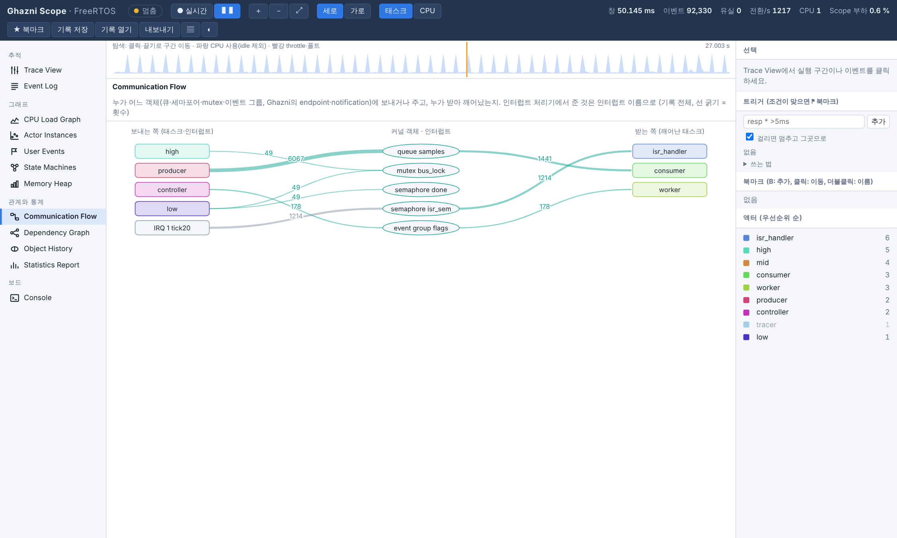

누가(왼쪽) 어느 객체(가운데)에 보내거나 주고, 누가(오른쪽) 받아 깨어났는지를 보여 줍니다. 선 굵기와 숫자는 횟수입니다. 인터럽트 처리기가 준 세마포어는 "IRQ 1 tick20"에서 나옵니다.

### 12. Dependency Graph
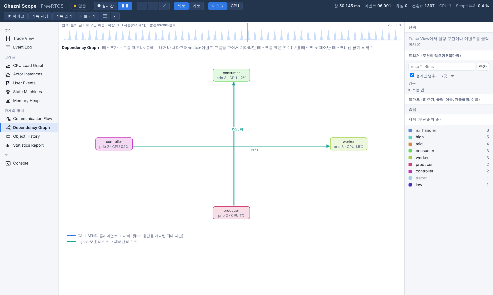

태스크 사이의 관계만 간추린 그림입니다. 누가 누구를 깨우는지 보여 줍니다.

### 13. Object History
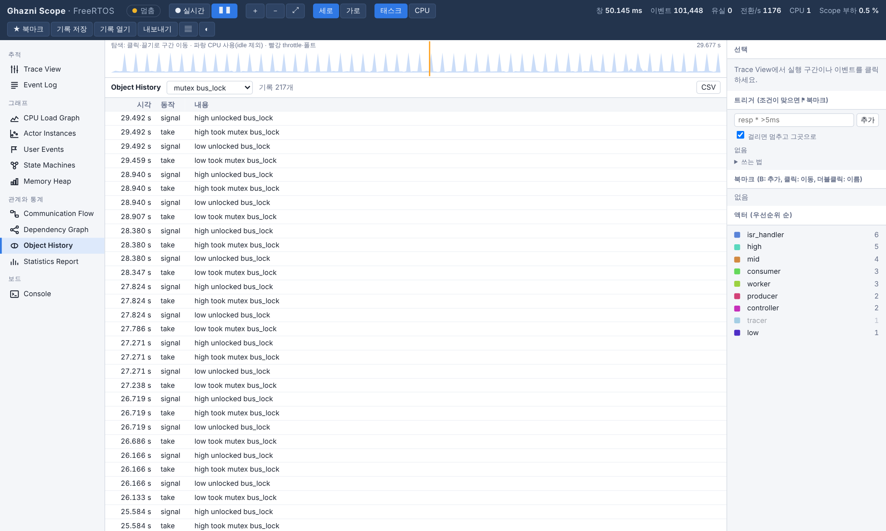

mutex `bus_lock` 하나에 일어난 일을 시간순으로 봅니다. 매 주기 low가 잡고 → low가 풀고 → high가 잡고 → high가 풉니다.

### 14. Statistics Report
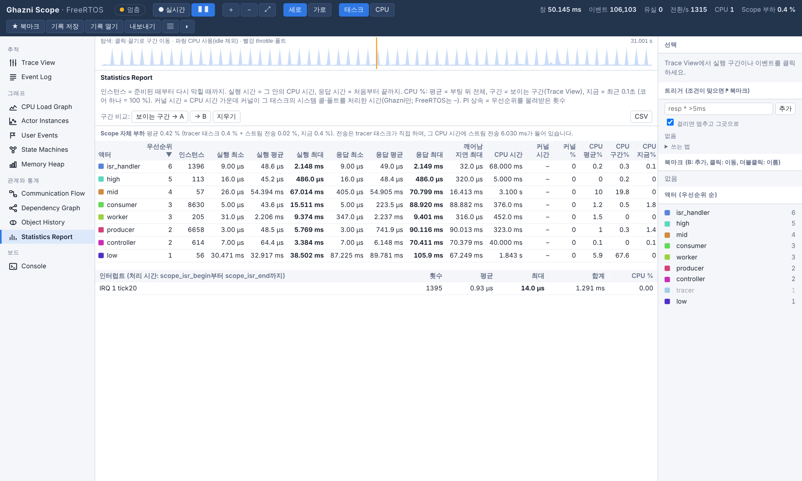

- 태스크마다 인스턴스 수, 실행·응답 시간(최소·평균·최대), 깨어남 지연, CPU %, 스택 사용량이 나옵니다.
- 아래 표는 인터럽트 처리 시간입니다.
- 맨 위에 Scope 자체 부하가 있습니다.

## 그 밖에

### 15. Console
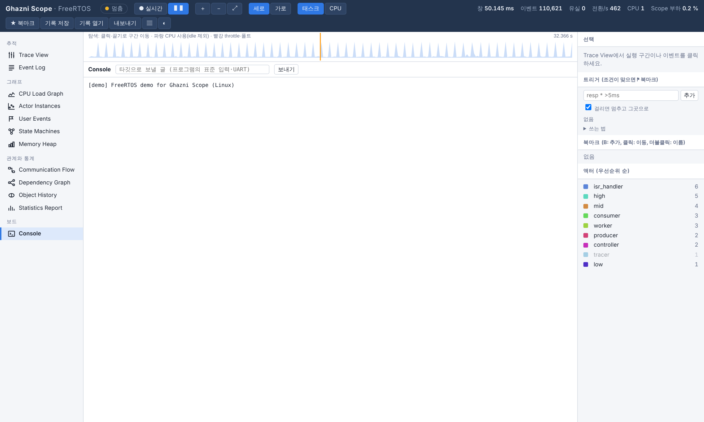

타깃의 콘솔 글입니다. 프레임 사이에 섞여 온 printf 출력이 여기에 나옵니다.

### 16. 어두운 화면
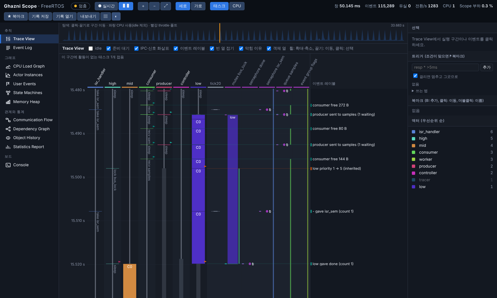

오른쪽 위 ◐ 단추로 바꿉니다. 고른 화면은 브라우저에 저장되어 다음에 열 때도 그대로입니다.

### 17. 조건 트리거
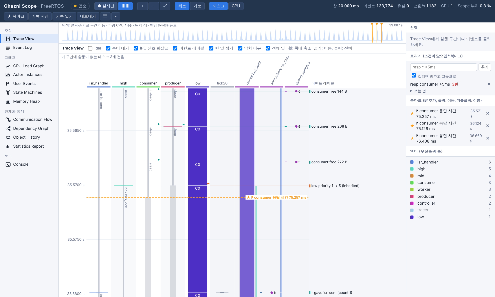

오른쪽에 `resp consumer >5ms`(consumer의 응답 시간이 5 ms를 넘으면)를 걸어 둔 화면입니다.

- 조건이 맞을 때마다 ⚑ 북마크가 생기고, 화면이 그 순간에서 멈춥니다.
- 이 장면은 consumer의 응답이 수십 ms나 걸린 이유를 보여 줍니다. mutex를 잡은 `low`가 상속받은 우선순위 5로 도는 동안, 우선순위 3인 `consumer`는 CPU를 받지 못하고 기다렸습니다(옅은 회색 띠).
